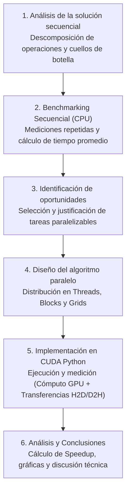
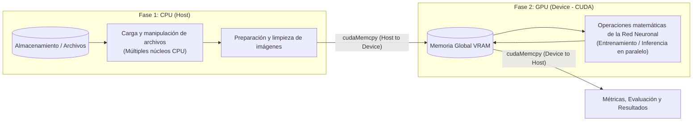

# Universidad del Valle de Guatemala
## Facultad de Ingeniería
### Departamento de Ciencias de la Computación
**CC3069 - Computación Paralela y Distribuida**  
**Semestre II - 2026**

---

# Proyecto 3: Mejorando algoritmos con CUDA

## I. Introducción

El propósito principal de este proyecto es mostrar una aplicación práctica y útil de la paralelización para optimizar y acelerar directamente un algoritmo real que ustedes ya hayan desarrollado previamente en el curso **Data Science**. 

Utilizando como base el **"Laboratorio 3. Deep Learning: Reconocimiento de Lenguaje de Señas ASL"**, el propósito fundamental es implementar sus soluciones utilizando la arquitectura de la GPU con **CUDA**, lo que nos permitirá medir y evaluar de manera práctica la mejora real en el rendimiento de procesamiento al trasladar la carga computacional hacia la GPU.

La traducción del Lenguaje de Señas Americano (ASL) en tiempo real es una aplicación de tecnología inclusiva que busca facilitar la comunicación mediante el reconocimiento de señas realizadas frente a una cámara. Este tipo de aplicaciones requiere procesar imágenes y realizar numerosas operaciones matemáticas para identificar y clasificar las señas. Su desarrollo puede abordarse mediante programación secuencial, utilizando la CPU, o mediante programación paralela, aprovechando la capacidad de procesamiento masivo de las GPU con tecnologías como CUDA.

---

## II. Instrucciones Generales

* **Conformación de equipos:** El proyecto se desarrollará en **equipos de 3 integrantes**.
* **Participación y control de versiones:** Todos los integrantes deberán participar activamente en cada uno de los pasos y documentar sus contribuciones mediante un **repositorio compartido**.

> ### 💡 Nota Adicional (Opción de Proyecto Alternativo)
> Tienen la opción de proponer la paralelización y aceleración de **otro laboratorio o proyecto** previamente desarrollado en su curso. 
> 
> Para habilitar esta opción, deberán presentar su propuesta **a más tardar el siguiente día de clases**, definiendo claramente los pasos equivalentes a realizar para su caso específico (incluyendo cómo se gestiona el trabajo en memoria, la separación de la carga de datos y la ejecución del componente computacionalmente pesado en GPU con CUDA).

---

## III. Metodología y Pasos a Desarrollar

> **Nota:** Deberán documentar y presentar evidencias de todos los datos utilizados, los procedimientos realizados y las decisiones tomadas durante el proceso de análisis y diseño de la solución.

### Paso 1. Análisis de la solución secuencial existente
Revisen el código de la solución desarrollada previamente. Identifiquen las principales partes del programa y expliquen brevemente cuál es la función de cada una.

Descompongan el programa en sus principales operaciones, desde la recepción de las imágenes hasta la obtención del resultado. Utilicen un formato similar a la siguiente tabla para registrar los datos:

| No. | Operación identificada | Descripción de su funcionamiento |
| :---: | :--- | :--- |
| 1 | *Ej. Lectura de imágenes* | *Descripción detallada...* |
| 2 | *Ej. Preprocesamiento* | *Descripción detallada...* |
| ... | ... | ... |

Identifiquen las operaciones que se ejecutan repetidamente y completen la siguiente tabla:

| Operación repetitiva | Datos que procesa | Cantidad de repeticiones |
| :--- | :--- | :--- |
| *Ej. Convolución / Forward pass* | *Tensores / Matrices de imagen* | *N épocas × M batches* |
| ... | ... | ... |

---

### Paso 2. Medición del tiempo de ejecución secuencial
* Ejecuten la solución secuencial desarrollada previamente y midan el tiempo utilizado para procesar un conjunto de imágenes.
* Realicen **varias ejecuciones** bajo las mismas condiciones para obtener resultados estadísticamente confiables y calcular el tiempo promedio ($T_{\text{CPU}}$).
* Documenten el procedimiento utilizado y presenten los resultados mediante tablas o gráficos.
* Analicen los tiempos obtenidos e identifiquen los factores que influyen en el rendimiento.

---

### Paso 3. Identificación de oportunidades de paralelización
* Analicen las operaciones identificadas en la solución secuencial y determinen cuáles pueden ejecutarse de forma simultánea utilizando CUDA.
* Seleccionen y justifiquen las operaciones que proponen paralelizar, explicando cómo se beneficiarán del procesamiento masivo en la GPU.

---

### Paso 4. Diseño del algoritmo paralelo
* Diseñen una propuesta de algoritmo paralelo utilizando CUDA, tomando como base las operaciones seleccionadas en el paso anterior.
* Determinen cómo se distribuirá la carga de trabajo entre la jerarquía de ejecución de la GPU (**hilos / threads**, **bloques / blocks** y **cuadrículas / grids**).

---

### Paso 5. Implementación con CUDA Python
* Implementen el algoritmo paralelo diseñado en la etapa anterior utilizando **CUDA Python**.
* Ejecuten la solución paralela desarrollada con CUDA bajo exactamente los mismos datos y condiciones empleados en la evaluación secuencial.
* Realicen varias pruebas y calculen el tiempo promedio ($T_{\text{GPU}}$), contabilizando tanto el **tiempo de procesamiento en los núcleos de la GPU** como el **tiempo de transferencia de datos entre CPU y GPU** (*Host-to-Device* y *Device-to-Host*).

---

### Paso 6. Análisis y conclusiones
* Comparen los resultados de ambas implementaciones (CPU vs. GPU) mediante tablas y gráficos comparativos.
* Calculen el factor de aceleración (**Speedup**) obtenido:
  $$\text{Speedup} = \frac{T_{\text{CPU}}}{T_{\text{GPU}}}$$
* Analicen si la paralelización permitió reducir efectivamente los tiempos de ejecución.
* Expliquen las posibles causas técnicas de las diferencias de rendimiento observadas (ej. overhead de transferencia de memoria, tamaño de batch, ocupación de GPU).

---

## IV. Arquitectura y Flujo de Trabajo Esperado

---

## V. Entregables

### 1. Código Fuente (Scripts o Jupyter Notebook)
* Un archivo `.py` o `.ipynb` debidamente documentado que contenga tanto el **código original secuencial** como la **nueva versión optimizada con CUDA**.
* El código debe evidenciar claramente la **separación del flujo de trabajo**:
  1. La fase de preparación y manipulación de datos (en CPU).
  2. La configuración y ejecución mediante CUDA en la fase de entrenamiento/cómputo pesado del modelo (en GPU).

### 2. Informe de Rendimiento y Análisis (Archivo PDF)
* **Tabla Comparativa de Tiempos:** Registros de ejecución secuencial vs. paralela (incluyendo tiempos de transferencia).
* **Cálculo de Speedup:** Métrica detallada para cada fase evaluada.
* **Evidencia de Hardware y Recursos:** Capturas de pantalla del monitor de recursos del sistema (Administrador de Tareas, `nvidia-smi` o equivalente) durante las ejecuciones, demostrando:
  * La carga de trabajo en los distintos núcleos del CPU durante la preparación de datos.
  * La saturación y uso activo de la memoria/núcleos de la GPU durante el procesamiento matemático.
* **Discusión Técnica:** Análisis profundo respondiendo explícitamente a las siguientes interrogantes:
  1. *¿Por qué es más eficiente procesar las imágenes/archivos con los múltiples núcleos del CPU y delegar exclusivamente la matemática de la red neuronal al GPU?*
  2. *¿Cómo CUDA permitió reducir o cambiar el tiempo de procesamiento?*
  3. *¿Qué factores justifican o limitan la utilización de CUDA?*

---

## VI. Rúbrica de Evaluación

| Criterio | Ponderación | Descripción de lo evaluado |
| :--- | :---: | :--- |
| **1. Refactorización de Código** | **40 puntos** | Scripts de Python (`.py` o `.ipynb`) actualizados y documentados que evidencien la correcta separación del pipeline: manipulación/preparación de imágenes estrictamente en CPU y operaciones matemáticas del entrenamiento del modelo aceleradas con CUDA en GPU. |
| **2. Evidencia de Ejecución** | **30 puntos** | Logs de consola y capturas de pantalla de monitores de recursos (`nvidia-smi`, Administrador de Tareas, etc.) que demuestren que el entorno reconoció y utilizó correctamente el hardware asignado en cada fase del flujo. |
| **3. Reporte de Análisis** | **30 puntos** | Informe técnico en PDF donde se calcule la métrica de **Speedup** alcanzada en las pruebas, se discuta técnicamente por qué la manipulación de archivos se mantuvo en el CPU mientras que la matemática de la red neuronal se delegó a la GPU, y se detallen las funciones/librerías adicionales utilizadas para operar con la GPU. |
| **TOTAL** | **100 puntos** | |