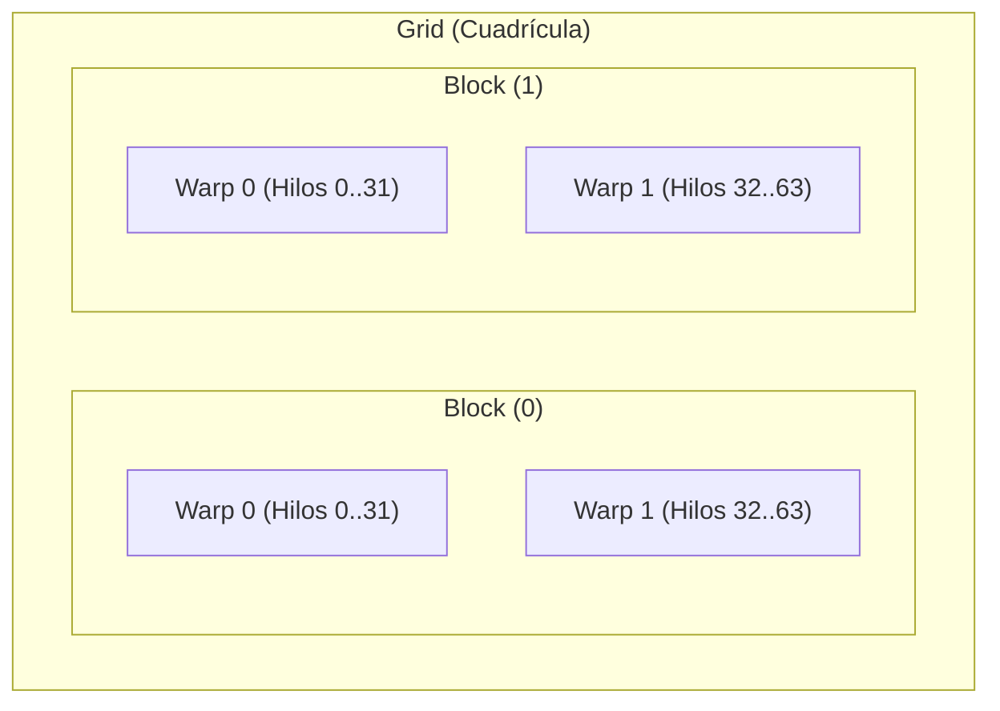
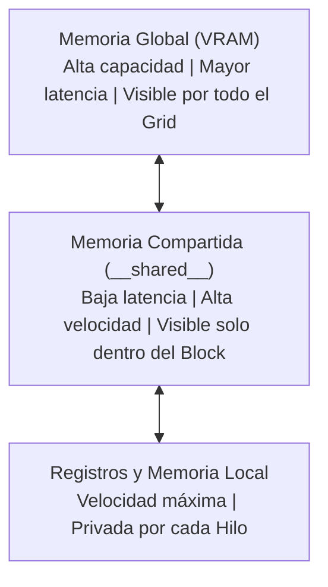
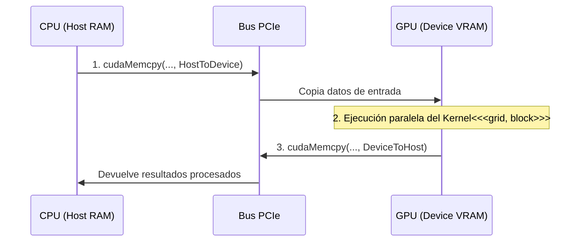

# Computación Paralela y Distribuida — Sección 20
## Semana 15: Programación con CUDA
**Catedrático:** Ing. Juan Luis García  
**Institución:** Universidad del Valle de Guatemala  

---

## 1. Introducción a CUDA

**CUDA** (*Compute Unified Device Architecture*) es una plataforma y modelo de programación paralelo desarrollado por **NVIDIA**.

* Permite a los desarrolladores acceder directamente al hardware de la GPU para tareas de cómputo paralelo de propósito general (*GPGPU*).
* Ideal para problemas que requieren procesamiento masivo de datos y una gran cantidad de operaciones aritméticas simultáneas.
* Las GPUs están arquitectónicamente diseñadas para manejar miles de operaciones de forma concurrente.
* **CUDA convierte a la GPU en un coprocesador de la CPU.**

### Diferencias Clave entre CPU y GPU

* **CPU (*Host*):** Baja latencia, pocos núcleos complejos optimizados para ejecución de tareas secuenciales y lógica de control compleja.
* **GPU (*Device*):** Alta latencia, miles de núcleos simples optimizados para procesamiento paralelo masivo y alto rendimiento (*throughput*).

---

## 2. ¿Por qué CUDA? y Comparativa con OpenMP

### Ventajas de CUDA
* Permite el desarrollo de aplicaciones paralelas para GPUs de manera mucho más sencilla e intuitiva en comparación con APIs gráficas de bajo nivel.
* Ofrece bibliotecas y APIs de alto nivel para una programación accesible y acelerada.

#### Principales áreas de aplicación:
* **Machine Learning e Inteligencia Artificial (IA)**
* **Simulaciones Científicas**
* **Renderizado de Gráficos**

### Comparación: OpenMP vs. CUDA

| Característica | OpenMP (CPU) | CUDA (GPU) |
| :--- | :--- | :--- |
| **Núcleos disponibles** | Docenas | Miles |
| **Complejidad de uso** | Baja | Media |
| **Tipos de tareas** | Paralelismo leve / moderado | Paralelismo masivo |
| **Caso de uso principal** | Fácil de implementar en arquitecturas multinúcleo convencionales. | Aprovecha al máximo el paralelismo masivo de datos en GPUs. |

---

## 3. Estructura Básica de un Programa CUDA ("Hello World")

Todo programa en CUDA se divide conceptualmente en dos espacios de ejecución:
1. **Código en el Host (CPU):** Gestiona la memoria, prepara los datos y lanza las llamadas hacia la GPU.
2. **Kernel (GPU):** Función marcada con `__global__` que se ejecuta en paralelo por múltiples hilos en el dispositivo.

### Ejemplo 1: Un bloque con 10 hilos (`<<<1, 10>>>`)

```cpp
#include <stdio.h>

// Definición del Kernel que se ejecutará en la GPU
__global__ void helloFromGPU() {
    printf("Hello World from GPU! Hilo: %d\n", threadIdx.x);
}

int main() {
    // Llamada al kernel: <<<número de bloques, número de hilos por bloque>>>
    helloFromGPU<<<1, 10>>>();

    // Sincronización: el host espera a que todos los hilos de la GPU terminen
    cudaDeviceSynchronize();
    
    return 0;
}
```

#### Compilación y Ejecución
```bash
nvcc hello.cu -o hello
./hello
```

**Salida esperada:**
```text
Hello World from GPU! Hilo: 0
Hello World from GPU! Hilo: 1
...
Hello World from GPU! Hilo: 9
```

### Ejemplo 2: Múltiples bloques y múltiples hilos (`<<<2, 5>>>`)

```cpp
#include <stdio.h>

__global__ void helloFromGPU() {
    printf("Hello from GPU! Bloque: %d, Hilo: %d\n", blockIdx.x, threadIdx.x);
}

int main() {
    // Lanzamiento de 2 bloques con 5 hilos cada uno (10 hilos en total)
    helloFromGPU<<<2, 5>>>();

    // Sincronización
    cudaDeviceSynchronize();
    
    return 0;
}
```

**Salida esperada:**
```text
Hello from GPU! Bloque: 0, Hilo: 0
Hello from GPU! Bloque: 0, Hilo: 1
...
Hello from GPU! Bloque: 1, Hilo: 0
Hello from GPU! Bloque: 1, Hilo: 1
...
```

---

## 4. Jerarquía de Ejecución: Grid, Bloques, Hilos y Warps



### Definición de Warp (Ejecución SIMD / SIMT)
* Un **warp** es un grupo fijo de **32 hilos** que se ejecutan simultáneamente en un **Multiprocesador de Flujo (SM - *Streaming Multiprocessor*)** de la GPU.
* Todos los hilos de un warp ejecutan la **misma instrucción al mismo tiempo**, pero operan sobre **datos diferentes**. Este paradigma se denomina **SIMD** (*Single Instruction, Multiple Data*).
* **División automática:** Al lanzar un bloque de hilos, el hardware lo particiona automáticamente en grupos de 32.
  * *Ejemplo:* Un bloque de $128$ hilos se divide en $\frac{128}{32} = 4\text{ warps}$.

### Variables Integradas de Indexación en CUDA

| Variable | Significado | Rango de Valores | Ejemplo ($10\text{ bloques}$, $256\text{ hilos/bloque}$) |
| :--- | :--- | :--- | :--- |
| `threadIdx.x` | Índice local del hilo dentro de su bloque (eje $X$). | $0 \dots (\text{blockDim.x} - 1)$ | $0$ a $255$ |
| `blockIdx.x` | Índice del bloque dentro de la cuadrícula / *grid* (eje $X$). | $0 \dots (\text{gridDim.x} - 1)$ | $0$ a $9$ |
| `blockDim.x` | Dimensión o cantidad total de hilos que contiene cada bloque (eje $X$). | Constante definida al lanzar el kernel | $256$ |

### Cálculo del Índice Global Único (`idx`)

Para mapear cada hilo de forma única sobre un arreglo unidimensional en memoria global se utiliza la fórmula estándar:

$$\text{idx} = \text{threadIdx.x} + \text{blockIdx.x} \times \text{blockDim.x}$$

#### Ejemplo práctico: Grid de $3$ bloques con $4$ hilos por bloque (`blockDim.x = 4`)

| `blockIdx.x` (Bloque) | `threadIdx.x` (Hilo) | Cálculo ($\text{threadIdx.x} + \text{blockIdx.x} \times 4$) | Índice Global (`idx`) |
| :---: | :---: | :---: | :---: |
| `0` | `0` | $0 + 0 \times 4$ | **0** |
| `0` | `1` | $1 + 0 \times 4$ | **1** |
| `0` | `2` | $2 + 0 \times 4$ | **2** |
| `0` | `3` | $3 + 0 \times 4$ | **3** |
| `1` | `0` | $0 + 1 \times 4$ | **4** |
| `1` | `1` | $1 + 1 \times 4$ | **5** |
| `1` | `2` | $2 + 1 \times 4$ | **6** |
| `1` | `3` | $3 + 1 \times 4$ | **7** |
| `2` | `0` | $0 + 2 \times 4$ | **8** |
| `2` | `1` | $1 + 2 \times 4$ | **9** |

---

## 5. ¿Cómo Decidir Cuántos Bloques e Hilos Utilizar?

Existen 4 criterios fundamentales para configurar la geometría de ejecución (`<<<numBlocks, threadsPerBlock>>>`):

1. **01. Tamaño del Problema:**
   * Dimensionar la cuadrícula en función de la cantidad total de elementos a procesar. Cada hilo procesa un fragmento de los datos.
   * *Ejemplo:* Para sumar dos arreglos de $1,000$ elementos, se requieren al menos $1,000$ hilos activos.
2. **02. Límites de Bloques e Hilos:**
   * Cada bloque tiene un límite físico de hardware (generalmente **hasta $1,024$ hilos por bloque** en arquitecturas modernas).
   * Si se requieren más hilos que el límite de un bloque, se deben lanzar múltiples bloques.
   * *Ejemplo:* Para $5,000$ hilos con límite de $1,024$, se requieren $5$ bloques completos ($5,120$ hilos en total, sobrando $120$ que deben filtrarse con `if (idx < N)`).
3. **03. La Regla de Oro (256 o 512 hilos por bloque):**
   * Usar **múltiplos de 32** (especialmente **256** o **512** hilos por bloque).
   * Esto asegura que todos los warps estén completamente llenos sin dejar hilos ociosos y maximiza la ocupación de los SM.
4. **04. Considerar la Memoria Disponible:**
   * La GPU posee recursos finitos de registros y memoria compartida por SM.
   * Si el kernel consume mucha memoria por hilo, se debe reducir el número de hilos por bloque para no exceder la capacidad de memoria compartida del bloque.

---

## 6. Sincronización de Hilos (`__syncthreads()`)

Cuando los hilos dentro de un mismo bloque cooperan compartiendo datos a través de la **memoria compartida**, es indispensable coordinar su avance mediante una barrera de sincronización:

```cpp
__syncthreads();
```

### Consecuencias de Omitir `__syncthreads()`
1. **Acceso a datos incorrectos:** Hilos rápidos podrían leer de memoria compartida antes de que hilos más lentos terminen de escribir sus resultados.
2. **Condiciones de carrera (*Race Conditions*):** Lecturas y escrituras concurrentes sin orden sobre la misma dirección de memoria compartida.
3. **Operaciones interrumpidas:** Avance prematuro a fases posteriores del algoritmo generando resultados corruptos.

### Reglas Críticas de `__syncthreads()`
* **Alcance intra-bloque:** Sincroniza **únicamente** a los hilos pertenecientes al **mismo bloque**. No existe sincronización directa entre bloques distintos dentro de un mismo kernel.
* **Prohibido en ramas condicionales divergentes:** Nunca debe colocarse dentro de un bloque `if-else` donde algunos hilos del bloque entren y otros no, ya que provocará un bloqueo indefinido (*deadlock*).

```cpp
// ❌ PELIGROSO: Puede causar deadlock si algunos hilos no cumplen la condición
if (threadIdx.x < 10) {
    __syncthreads(); 
}
```

---

## 7. Reducción de la Divergencia de Hilos (*Warp Divergence*)

### ¿Qué es la Divergencia de Hilos?
Ocurre cuando los hilos dentro de un mismo **warp** toman rutas de ejecución distintas debido a estructuras de control condicional (`if-else`, `switch`, bucles con límites variables). 

Dado que un warp ejecuta instrucciones bajo el modelo SIMD, la GPU se ve obligada a **serializar** cada rama (ejecutando primero los hilos que cumplen el `if` mientras desactiva los demás, y luego los del `else`), degradando severamente el paralelismo.

### Ejemplo: Con Divergencia vs. Sin Divergencia

```cpp
// ❌ CON DIVERGENCIA: Hilos pares e impares del mismo warp siguen caminos separados
__global__ void kernelConDivergencia(int *data) {
    int idx = threadIdx.x + blockIdx.x * blockDim.x;
    if (idx % 2 == 0) {
        data[idx] *= 2;
    } else {
        data[idx] += 1;
    }
}

// ✅ SIN DIVERGENCIA: Todos los hilos ejecutan la misma secuencia aritmética / predicada
__global__ void kernelSinDivergencia(int *data) {
    int idx = threadIdx.x + blockIdx.x * blockDim.x;
    data[idx] = (idx % 2 == 0) ? (data[idx] * 2) : (data[idx] + 1);
}
```

---

## 8. Jerarquía y Tipos de Memoria en CUDA



| Tipo de Memoria | Alcance / Visibilidad | Velocidad / Latencia | Propósito y Ejemplo de Uso |
| :--- | :--- | :--- | :--- |
| **Registros** | Privada por hilo | La más rápida (en chip) | Variables escalares individuales de cada hilo. |
| **Memoria Local** | Privada por hilo | Rápida (si cabe en registros) o lenta (si va a VRAM) | Variables locales grandes o arreglos estáticos por hilo. |
| **Memoria Compartida** (`__shared__`) | Todos los hilos de un **mismo bloque** | Muy rápida (en chip) | Caché gestionada por el programador para reutilizar datos entre hilos de un bloque (ej. sub-matrices / *tiles*). |
| **Memoria Global** | Todos los hilos de **todos los bloques** y el Host | Más lenta (VRAM externa) | Almacenamiento de grandes volúmenes de datos de entrada y salida. |

### Optimización con Memoria Compartida
* **Patrón eficiente:** Cargar bloques de datos desde la memoria global hacia un arreglo `__shared__ int sharedData[BLOCK_SIZE];`, llamar a `__syncthreads()`, realizar múltiples cálculos rápidos en memoria compartida y escribir el resultado final de vuelta en memoria global.

---

## 9. Acceso Eficiente a Memoria: Coalescencia (*Memory Coalescing*)

El controlador de memoria de la GPU agrupa las peticiones de memoria de los hilos de un warp en transacciones de bloque.

* **Acceso Coalescido (Óptimo):** Hilos consecutivos (`threadIdx.x = 0, 1, 2...`) acceden a posiciones de memoria **contiguas y alineadas**. La GPU satisface múltiples lecturas en una sola transacción de bus.
  ```cpp
  int idx = threadIdx.x + blockIdx.x * blockDim.x;
  A[idx] = B[idx] + C[idx]; // Contiguo -> Coalescido ✅
  ```
* **Acceso No Coalescido (Lento):** Hilos consecutivos acceden a direcciones dispersas o con saltos (*strides*). La GPU debe emitir múltiples transacciones separadas, desperdiciando ancho de banda.
  ```cpp
  int idx = threadIdx.x * stride;
  A[idx] = B[idx] + C[idx]; // Disperso -> No coalescido ❌
  ```

### Escenarios comunes donde ocurre acceso no coalescido:
1. **Matrices dispersas (*Sparse Matrices*):** Estructuras comprimidas donde los datos válidos no están alineados contiguamente.
2. **Estructuras con salto de índice (*Strided access*):** Procesar un único canal de color (ej. solo el canal Rojo) en imágenes RGB intercaladas en memoria.
3. **Patrones específicos de algoritmos:** Transformada Rápida de Fourier (FFT) o filtros de convolución complejos.
4. **Algoritmos basados en grafos:** Búsqueda de caminos o recorridos de nodos almacenados de forma no contigua en memoria.

---

## 10. Transferencia de Datos entre CPU (Host) y GPU (Device)



La comunicación a través del bus PCIe entre la CPU y la GPU es **significativamente más lenta** que el cómputo interno dentro de los núcleos de la GPU, representando frecuentemente el mayor cuello de botella.

```cpp
// Copia de CPU (Host) hacia GPU (Device)
cudaMemcpy(d_destino, h_origen, tamano_bytes, cudaMemcpyHostToDevice);

// Copia de GPU (Device) hacia CPU (Host)
cudaMemcpy(h_destino, d_origen, tamano_bytes, cudaMemcpyDeviceToHost);
```

### 4 Estrategias para Minimizar el Impacto de las Transferencias

1. **01. Transferir datos en bloque al inicio:** Enviar todos los datos necesarios al comienzo de la ejecución en una sola transferencia grande en lugar de realizar múltiples transferencias pequeñas.
2. **02. Reutilización de datos en la GPU:** Si un conjunto de datos pasa por múltiples kernels secuenciales, mantener los resultados intermedios en la VRAM de la GPU y copiar de vuelta a la CPU únicamente al finalizar todo el flujo.
3. **03. Transferencia Asíncrona (`cudaMemcpyAsync`) y Streams:** Solapar el movimiento de datos con la ejecución de cómputo en segundo plano utilizando *CUDA Streams* para ocultar la latencia:
   ```cpp
   cudaMemcpyAsync(d_A, h_A, N * sizeof(int), cudaMemcpyHostToDevice, stream);
   ```
4. **04. Reducir el volumen de datos transferidos:** Enviar exclusivamente las porciones o subconjuntos de matrices que realmente serán procesados.

---

## 11. Resumen de Comandos y Calificadores Clave de CUDA

| Comando / Calificador | Función Principal |
| :--- | :--- |
| `__global__` | Calificador que declara una función como un **kernel** que se llama desde el host (CPU) y se ejecuta en el dispositivo (GPU). |
| `cudaMalloc()` | Reserva un bloque de memoria en la **memoria global** de la GPU (VRAM). |
| `cudaMemcpy()` | Copia bloques de memoria de forma síncrona entre el Host (CPU) y el Device (GPU) o viceversa. |
| `cudaDeviceSynchronize()` | Bloquea la ejecución del hilo de la CPU hasta que todos los kernels lanzados previamente en la GPU hayan finalizado. |
| `cudaFree()` | Libera memoria previamente reservada en la GPU mediante `cudaMalloc()`. |
| `__shared__` | Calificador que declara una variable o arreglo en **memoria compartida** de alta velocidad, visible por todos los hilos de un mismo bloque. |
| `__syncthreads()` | Barrera de sincronización que detiene a todos los hilos de un **mismo bloque** hasta que todos alcancen ese punto del código. |