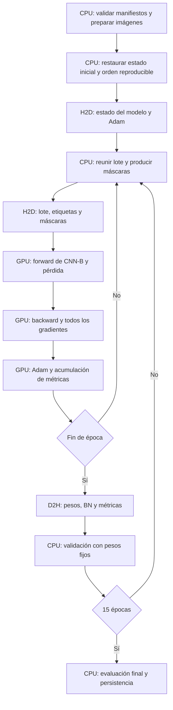

# Paso 4. Diseño del algoritmo paralelo CUDA

Versión documental: **DIS-CUDA-001, revisión 1**. Estado: **propuesta de diseño
completa para el alcance CNN-B; implementación y validación pendientes**.
Responsable: Codex por solicitud del usuario; revisión humana pendiente.
Relaciones: REQ-05/06/07/09/12, PROC-12, DEC-017/018/019/020, CAM-005, BIT-007.

La autoridad es [Proyecto 3 CUDA.pdf](../Proyecto%203%20CUDA.pdf), página 2,
apartados 3–5 y página 3, separación CPU/GPU. Se parte de las nueve operaciones
del [paso 3](oportunidades-paralelizacion.md). Este diseño incluye contratos,
algoritmos matemáticos y configuraciones propuestas. No contiene implementación
ejecutable, no crea un experimento ni demuestra funcionamiento o velocidad CUDA.

## 1. Documentos que forman el diseño

| Documento | Responsabilidad |
|---|---|
| Este documento | Alcance, arquitectura, contratos, planificación y memoria |
| [Catálogo de kernels](diseno-kernels-cuda.md) | Fórmulas, índices, threads/blocks/grids, reducciones y prevención de carreras |
| [Validación y medición](diseno-validacion-cuda.md) | Equivalencia CPU/GPU, aleatoriedad, tolerancias, errores, cronometraje y evidencias |
| [Inspección del diseño](../../resultados/diseno/paso-4-inspeccion.md) | Inventario observado, fuentes locales, hashes y cálculos derivados |
| [Contraste con Semana15](contraste-semana-15.md) | Correspondencia con clase, precisiones técnicas y ajuste de coalescencia |

Estos documentos son una única propuesta. Una condición de aceptación
pendiente de ejecutar no es una decisión algorítmica sin resolver. La asignación
de registros, ocupación real, compatibilidad de paquetes y rendimiento únicamente
pueden comprobarse al implementar; no se certifican mediante esta revisión.

## 2. Alcance y decisiones cerradas

1. Entrenar **una CNN-B base**, sin aumento de imágenes, durante 15 épocas fijas,
   batch 128, sin EarlyStopping, manteniendo el último lote de 20 imágenes.
2. Conservar los mismos 17,400 archivos, splits, clases, normalización y pesos
   iniciales preservados en EXP-002. No incorporar el test oficial de 28 imágenes
   ni las fotos propias al entrenamiento. No seleccionar arquitectura por test.
3. CPU: lectura/decodificación/preparación, orden de muestras, máscaras Dropout,
   orquestación, validación, evaluación final, métricas de informe y persistencia.
   GPU: forward de entrenamiento, pérdida, backward y Adam exclusivamente.
4. Validar cada época **en CPU**, copiando pesos y estadísticas BN desde GPU.
   Esas copias y la validación se incluyen en el entrenamiento total comparable.
   Esta interpretación conserva estrictamente CUDA en la fase de entrenamiento
   exigida por el PDF; no amplía esta propuesta a inferencia CUDA.
5. Precisión FP32 para tensores, pesos, acumuladores y Adam; sin mixed precision,
   TF32, fastmath ni Tensor Cores. Índices globales y tamaños en int64; máscaras y
   posiciones locales de pooling en uint8. Labels en int64.
6. Un dispositivo, un proceso de entrenamiento, un stream CUDA explícito;
   transferencias y cómputo ordenados, sin solapamiento. No multigpu, streams
   concurrentes, acumulación de gradientes, cambio de batch ni fusión entre capas.
7. Kernels Python explícitos con **NVIDIA numba-cuda**, interfaz `numba.cuda`,
   y bindings NVIDIA CUDA Python para acceso al driver según su distribución.
   No se delega entrenamiento a un `fit` GPU ni a kernels ocultos cuDNN/cuBLAS.
   Numba-CUDA permite expresar kernels y jerarquía CUDA desde Python según su
   [documentación oficial](https://nvidia.github.io/numba-cuda/user/kernels.html).
8. CPU pareada: TensorFlow/Keras CPU, misma CNN-B y un adaptador futuro que reciba
   orden y máscaras explícitos. Esta modificación controlada requiere **un EXP
   nuevo para ambos dispositivos**, sin editar EXP-002. No hay código del adaptador
   en este paso. Las otras CNN, FC, PCA/RF y augmentation quedan fuera del alcance
   de este diseño, conforme a la prioridad seleccionada en el paso 3.

### Entorno de destino y condición previa

Se observó mediante consulta de inventario una **NVIDIA GeForce GTX 1650,
4096 MiB, compute capability 7.5, driver 591.59**. No se ejecutó ningún kernel.
PCUDA conserva Python 3.14.3 y TensorFlow 2.22.0rc0 CPU; no tiene instalados
numba, numba-cuda ni cuda-python según sus metadatos. No se instalaron paquetes.

Perfil objetivo: Windows x64, dispositivo sm_75 y toolchain CUDA 12.x compatible.
No se interpreta la versión máxima anunciada por un driver como toolkit instalado.
La [guía de instalación de Numba-CUDA](https://nvidia.github.io/numba-cuda/user/installation.html)
describe los componentes necesarios y su dependencia de bindings NVIDIA. Antes
de implementar se debe resolver y archivar un lock de versiones que admita
**simultáneamente** Python 3.14.3, NumPy 2.5.5 y Windows. No se fuerza una versión
incompatible, no se degrada PCUDA y no se reinstalan sus dependencias existentes.
Si no existe combinación compatible, se registra bloqueo de entorno y se plantea
un entorno separado sin alterar PCUDA; ambas referencias deben medirse en las
condiciones efectivamente documentadas. La elección de otro backend exige DEC/CAM.

Este es un criterio de admisión del entorno, no una garantía de compatibilidad.
El diseño de kernels no depende de elegir una versión sin haberla probado.

## 3. Contratos de entrada e identidad

| Objeto | Contrato |
|---|---|
| Imágenes | NHWC, C-contiguo, RGB, 64×64×3, float32, finitas, división /255 una sola vez |
| Train / val / test | 12,180 / 2,610 / 2,610, orden base del manifiesto, sin resample |
| Etiquetas | int64, 0 ≤ etiqueta < 29; mapeo congelado, nunca reordenado por observación |
| Pesos convolucionales | `[3,3,Cin,Cout]`, correlación cruzada, stride 1, padding SAME de un cero por lado, dilation 1, groups 1, bias presente |
| Pesos Dense | `[Nin,Nout]`, bias presente, Flatten NHWC en orden C |
| BatchNormalization | axis=-1, momentum=0.9, epsilon=0.001, gamma/beta entrenables, media/varianza móviles no entrenables, renorm=False |
| MaxPooling | 2×2, stride 2, VALID, desempate por primera posición en orden fila/columna |
| Dropout | Probabilidades 0.25 / 0.25 / 0.30 / 0.40, máscara por elemento, escalado invertido; identidad en validación |
| Pérdida | Sparse categorical crossentropy desde logits, media sobre **b real**, sin pesos de clase ni regularización adicional |
| Adam | lr=0.001, beta1=0.9, beta2=0.999, epsilon=1e-7, sin AMSGrad, weight decay, clipping, EMA ni loss scaling |

Los defaults relevantes se contrastaron con archivos Keras de PCUDA; hashes en
la inspección. La documentación oficial de [BatchNormalization](https://keras.io/api/layers/normalization_layers/batch_normalization/)
y [Adam](https://keras.io/api/optimizers/adam/) sirve de apoyo técnico; el original
local determina los parámetros concretos utilizados aquí.

Checkpoint inicial: CNN-B.estado-inicial.npz de la primera corrida correcta
EXP-002, identificado en su manifiesto sellado. Importar pesos, bias, gamma,
beta, medias/varianzas móviles y estados iniciales Adam; no volver a inicializar
por la coincidencia de una semilla. Mapear por **ordinal de capa y rol**, verificando
forma, dtype, cantidad, valores y huella canónica; no por posición casual en un
diccionario ni por nombres autogenerados. Si no coincide, detener antes de medir.

El NPZ inicial inspeccionado contiene80 arreglos: arr_0..arr_33 corresponden a
model.variables y los restantes al optimizador. Los cuatro estados int64[2] de
generadores Dropout (arr_8/17/24/31) se conservan como procedencia, pero no se
transfieren como pesos ni se usan con el nuevo contrato de máscaras. arr_34 es
el contador Adam int64 inicial0. Hay75 arreglos flotantes,6736696 valores,
incluido el escalar learning rate. El importador debe contrastar esta estructura
con roles de un clon CPU y generar el manifiesto de correspondencia; no inferir
roles solo por shape. Los estados RNG sustituidos son un cambio explícito del
protocolo, no parte de una supuesta identidad binaria del modelo completo antiguo.

## 4. Arquitectura exacta y formas

`b` es 128 o 20 en entrenamiento. ReLU forma parte de cada Conv/Dense indicada:
**Conv→ReLU→BN**, no Conv→BN→ReLU. Mantener ese orden es necesario para equivalencia.

| ID | Operación | Forma de salida por lote | Parámetros entrenables | Estado adicional |
|---|---|---|---:|---|
| X | Entrada | b×64×64×3 | 0 | — |
| C1 | Conv 3×3,32 + bias + ReLU | b×64×64×32 | 896 | — |
| B1 | BN | b×64×64×32 | 64 | 64 medias/varianzas |
| C2 | Conv 3×3,32 + bias + ReLU | b×64×64×32 | 9248 | — |
| P1 | MaxPool | b×32×32×32 | 0 | Índice local de máximo |
| D1 | Dropout .25 | b×32×32×32 | 0 | Máscara |
| C3 | Conv 3×3,64 + bias + ReLU | b×32×32×64 | 18496 | — |
| B2 | BN | b×32×32×64 | 128 | 128 medias/varianzas |
| C4 | Conv 3×3,64 + bias + ReLU | b×32×32×64 | 36928 | — |
| P2 | MaxPool | b×16×16×64 | 0 | Índice local de máximo |
| D2 | Dropout .25 | b×16×16×64 | 0 | Máscara |
| C5 | Conv 3×3,128 + bias + ReLU | b×16×16×128 | 73856 | — |
| B3 | BN | b×16×16×128 | 256 | 256 medias/varianzas |
| P3 | MaxPool | b×8×8×128 | 0 | Índice local de máximo |
| D3 | Dropout .30 | b×8×8×128 | 0 | Máscara |
| V | Flatten, vista | b×8192 | 0 | Sin copia |
| F1 | Dense256 + bias + ReLU | b×256 | 2097408 | — |
| B4 | BN | b×256 | 512 | 512 medias/varianzas |
| D4 | Dropout .40 | b×256 | 0 | Máscara |
| Z | Dense29 + bias | b×29 logits | 7453 | — |
| S | Softmax y pérdida | b×29 y b pérdidas | 0 | Reducciones |

Total: **2,245,245 parámetros entrenables**, 960 valores de estado BN,
**2,246,205 valores de modelo**. No se contabilizan estados Adam como parámetros
de la arquitectura. La salida softmax original se expresa como logits y softmax
separados para pérdida estable, preservando su definición matemática.

## 5. Preparación CPU y fronteras

Preparación propuesta: ThreadPoolExecutor de **6 workers**, hasta **12 tareas
pendientes**, mismo procedimiento Pillow que el original. El coordinador reserva
X/y y escribe cada resultado en su índice del manifiesto, independientemente del
orden de terminación. Cada worker abre/cierra un archivo, convierte RGB, resize
BICUBIC sin EXIF transpose, convierte float32 y divide /255. No añade recorte,
augmentation, cambio de color ni limpieza silenciosa. Cada llamada trabaja sobre
un archivo y un arreglo propios; el coordinador es el único escritor de X/y.

El tamaño de tarea es una imagen; la cola acotada evita acumular copias completas.
Ante un archivo inválido se aborta la preparación conservando archivo/índice/error,
sin omitirlo ni reemplazarlo. Antes de medir se verifica igualdad de bytes frente
a los tensores congelados. El uso de seis workers es propuesta, no rendimiento
observado: cualquier beneficio se mide en ambas variantes nuevas. Para comparar
1 vs 6 workers se abre una variante separada, sin cruzar la referencia vieja de
un worker con la nueva de seis para atribuir una mejora a CUDA.

Los tres tensores permanecen en RAM CPU (815.625 MiB de imágenes en total).
No se cargan completos en GPU ni se transfieren val/test a GPU. El coordinador
reúne cada lote train contiguo según la permutación de la época y genera las
cuatro máscaras compartidas. Su tiempo se incluye en el entrenamiento en ambos
dispositivos; hashes y archivos de auditoría se calculan fuera de los intervalos
de rendimiento, con el mismo calendario en CPU/GPU.

## 6. Algoritmo global y orden de dependencias

Secuencia de una repetición, aún sin ejecutar:

1. Admitir entorno y archivos; preparar e identificar datos. Crear el modelo CPU
   de validación y los buffers device fuera del tramo de régimen estable.
2. Compilar/calentar **todas** las familias de kernels y las formas b=128/20;
   calentar también validación CPU b=128/50 y test b=32/18. No medir compilación
   como entrenamiento estable. Restaurar modelo completo, Adam, BN, contadores,
   orden y máscaras después del warmup; verificar restauración.
3. Iniciar el intervalo total de entrenamiento **antes** de transferir el estado
   inicial restaurado. H2D incluye pesos, BN, m/v y contador; no atribuir cero por
   haberlos enviado durante el warmup.
4. Para cada época e=0..14 crear su permutación compartida. Para j=0..95 reunir
   las muestras y máscaras de ese paso; H2D al stream único y ejecutar forward.
5. Calcular loss y accuracy sobre predicciones anteriores a Adam, backward en
   orden inverso y todos los gradientes de esa versión de pesos. **No actualizar
   una capa hasta terminar todos los gradientes que usan sus pesos anteriores.**
6. Ejecutar Adam para cada parámetro y aumentar el contador global una sola vez
   por lote, no una vez por tensor. BN actualiza sus medias/varianzas una sola vez
   en el forward de entrenamiento. No se actualizan por validación o backward.
7. Tras 96 pasos: sincronizar, D2H de modelo completo y métricas; cargar el modelo
   espejo CPU y validar 2610 imágenes, batch128: 20 lotes completos y uno de 50,
   sin alterar pesos/BN/Adam. Incluir transferencia y carga en el tiempo total.
8. Tras la época 15: D2H final de estados Adam para conservación y finalizar el
   intervalo. La última copia de pesos ya es la de validación de la época15; no
   copiarla de nuevo sin necesidad. Evaluar test en CPU batch32, 81 lotes completos
   y uno de 18; registrar su tiempo aparte. No hay selección adaptativa de modelo.
9. Verificar finitud, 1440 actualizaciones, estados y evidencias; guardar fuera
   de los tiempos de proceso. Ante error, conservar RUN fallido sin sustituirlo.

No se descarta el último lote. Ningún hilo asume b=128 cuando b=20. No se interpreta
el bucle de épocas o los lotes consecutivos como tareas independientes.

## 7. Distribución de la carga

Las fórmulas completas están en el [catálogo](diseno-kernels-cuda.md). Resumen:

| Familia | Trabajo de un thread | Block propuesto | Grid lógico |
|---|---|---|---|
| Conv/Dense forward y gradiente de entrada | Una salida de un producto matricial real o implícito | (16,16,1), 256 threads | (ceil(N/16),ceil(M/16),1) |
| Gradiente de pesos | Una contribución de peso para una partición de reducción | (16,16,1), 256 threads | (ceil(N/16),ceil(M/16),ceil(K/2048)) |
| Fusión de parciales de pesos | Un peso definitivo | (256,1,1) | min(4096,ceil(num_pesos/256)), con recorrido por stride |
| ReLU backward, Dropout fwd/bwd, BN aplicación/dX, Adam | Un elemento en cada iteración del recorrido por stride | (256,1,1) | min(4096,ceil(num_elementos/256)) |
| Pooling forward/backward | Una salida / una entrada respectivamente | (256,1,1) | min(4096,ceil(num_elementos/256)) |
| Estadísticas BN, gradientes gamma/beta y bias | Parciales por canal, lectura contigua de32canales por warp | (32,8,1), 256threads | (ceil(L/2048),ceil(C/32),1), seguido de reducción final block256/grid(C,1,1) |
| Softmax/pérdida y dLogits | Una clase de una muestra; lanes sobrantes neutras | (32,1,1) | (b,1,1) |
| Métricas de lote/época | Parciales y acumulación por componentes de métrica | (256,1,1) y (1,1,1) | (1,1,1) en ambos pases |

Los tamaños son decisiones de diseño conservadoras, no parámetros óptimos medidos.
Las matrices implícitas no se materializan: evita im2col completo y su memoria.
El reparto entre SM/warps lo gestiona el planificador del dispositivo; no se
promete un SM por block ni residencia simultánea de todos los blocks.

## 8. Memoria, vida útil y transferencias

La unidad MiB equivale a 2^20 bytes. Se reserva una sola arena por categoría antes
de medir; cada salida tiene dueño y posición fija. No hay asignaciones de memoria
device dentro del bucle. Los buffers no inicializados se escriben por completo
antes de leerlos. No se utiliza memoria unificada ni transferencias implícitas de
arreglos NumPy: la [API de memoria](https://nvidia.github.io/numba-cuda/user/memory.html)
permite controlar buffers y copias expresamente.

| Reserva device, b máximo128 | Presupuesto | Vida útil y regla |
|---|---:|---|
| Entrada y salidas forward separadas | 382.4034 MiB | Todas las activaciones de la tabla; Flatten es vista; se conservan hasta backward |
| Dos buffers de gradientes de activación | 128 MiB | 64 MiB cada uno, ping-pong en orden inverso; nunca alias con entrada aún leída |
| Parámetros, gradientes de parámetros, m/v y BN móvil | 34.2634 MiB | 4×2245245×4 + 960×4 bytes; persistentes |
| Parciales dW compartidos entre capas | 16 MiB | Máximo calculado9 MiB, reutilizar solo tras reducción final de esa capa |
| Estadísticas BN y workspace de reducciones | 4 MiB | Media, varianza, sumas, invstd y parciales; reutilización ordenada |
| Cuatro máscaras Dropout uint8 | 7.03125 MiB | Persisten hasta su backward; no regenerar dentro de backward |
| Índices de tres pooling uint8 | 7 MiB | Una posición local0..3 por salida, retenida hasta backward |
| Etiquetas, pérdidas, flags y contadores | ≤1 MiB | Incluye métricas y estado de error; inicialización explícita |
| **Suma presupuestada** | **<680 MiB** | No incluye contexto/driver/código JIT |
| **Tope de buffers propios** | **768 MiB** | Incumplimiento detiene la corrida, no reduce batch silenciosamente |

Las activaciones separadas evitan escrituras in-place peligrosas. Solo se fusiona
Conv/Dense+bias+ReLU en su propio resultado, y softmax/pérdida/dLogits en el mismo
block por muestra. Backward obtiene la derivada ReLU de la salida ReLU retenida;
no necesita conservar preactivación adicional. BN conserva su entrada y media/
invstd, y recalcula xhat; no reserva otro tensor completo. Pool backward escribe
también ceros en posiciones no máximas sin una limpieza global adicional.

La arena de 16 MiB de dW usa **dimensiones reales**, no padding físico a múltiplos
de16. Los hilos de borde no escriben un parcial inexistente. Si una implementación
decide materializar padding o xhat, debe recalcular presupuesto y documentar CAM.

Admisión: consultar memoria libre tras crear contexto/JIT y antes de reservar;
exigir al menos **1536 MiB libres** y comprobar límites de 256 threads/block,
dimensiones y shared memory por kernel. No se interpreta memoria libre del
inventario como reserva garantizada. Fallo de reserva o menos memoria libre
detiene el RUN; no se cambia batch, arquitectura ni precisión automáticamente.

Host: buffers pinned reutilizables para un lote de imágenes (6 MiB), etiquetas
(1024 bytes), cuatro máscaras (7.03125 MiB) y modelo exportado (~8.569 MiB).
Los tres datasets permanecen en RAM normal. La fijación pinned no implica
solapamiento en este perfil. No se reutiliza un buffer Host hasta completar su
copia; sincronizar el stream antes de llenarlo de nuevo.

Los kernels reciben b y dimensiones lógicas explícitas: un buffer con capacidad
128 no convierte un lote de20 en128. Solo se copia y procesa el prefijo válido;
la cola puede conservar valores antiguos y nunca debe leerse. Antes de admitir
una corrida se exigen además4096MiB de RAM Host disponible; el consumo real del
backend CPU se monitoriza y no se deduce de la suma de tamaños de tensores.

| Dirección y contenido | Frecuencia y bytes lógicos |
|---|---|
| H2D inicial: pesos, BN y Adam | Una vez por repetición medida, después de restaurar; registrar bytes exactos incluyendo escalares |
| H2D imágenes | 12180×12288×4 bytes por época; 15 épocas; sin val/test |
| H2D etiquetas | 12180×8 bytes por época |
| H2D máscaras | 12180×57600 bytes por época; incluye solo b real, no cola del buffer máximo |
| D2H modelo para validar | 2246205×4 = 8984820 bytes por época; incluye BN no entrenable |
| D2H métricas y flags | Una vez por época, tamaño real registrado; estado de error también en límites de paso |
| D2H m/v y contador final | Una vez al terminar, para reproducibilidad; incluido en entrenamiento total |

No se omite el coste de staging CPU, generación de máscaras, copias o validación
al presentar el total. Los conteos son bytes de payload, no tráfico PCIe efectivo
medido. La política de flags y la descomposición temporal se detallan en validación.

## 9. Sincronización, fallos y riesgos

Todas las dependencias entre kernels se resuelven por orden del stream único;
un kernel siguiente no lee parciales antes de finalizar el productor. Una barrera
de block no sincroniza blocks distintos. Las reducciones globales siempre tienen
un lanzamiento posterior. No se utilizan atómicos flotantes, acumulaciones
concurrentes sobre pesos ni actualización anticipada de Adam.

El perfil no garantiza speedup. GEMM FP32 explícito puede ser más lento que
bibliotecas especializadas; indexación implícita, muchos lanzamientos, máscaras
transferidas y validación CPU pueden dominar. La simplificación facilita rastrear
exactamente cada operación y cumplir la jerarquía explícita requerida. Cualquier
optimización posterior requiere mantener pruebas y declarar cambios antes de medir.

En Windows, un kernel largo puede ser interrumpido por el watchdog gráfico. Se
limitan filas por lanzamiento en el catálogo; no se desactiva TDR ni se cambia
el registro del sistema. Si el calentamiento detecta tiempos por lanzamiento
superiores a500 ms, no se inicia medición: registrar y revisar la partición en
una nueva revisión del diseño. No se afirma que500 ms sea el umbral del SO.

NaN/Inf, forma o etiqueta inválida, overflow de índices, incompatibilidad de
checkpoint, incumplimiento de tolerancias, fallo de driver o CUDA simulator
detectado invalidan la admisión. No se usa CPU silenciosamente para fingir GPU.

## 10. Cierre documental y entregables futuros

La propuesta especifica las nueve oportunidades del paso3 y sus contratos de
ejecución, memoria, aleatoriedad, fronteras, pruebas y medición. REQ-05 queda
cubierto **a nivel de diseño**, aún sin vínculo con código ejecutable.

En paso5 se deberán crear, sin editar el original: adaptador de datos/referencia
CPU, kernels y controlador CUDA Python, importador/exportador de estados,
comprobaciones de equivalencia y un EXP nuevo congelado con versiones efectivas.
Son componentes previstos, **no archivos implementados**. Las evidencias de
hardware activo, capturas, mediciones y PDF final siguen pendientes.
