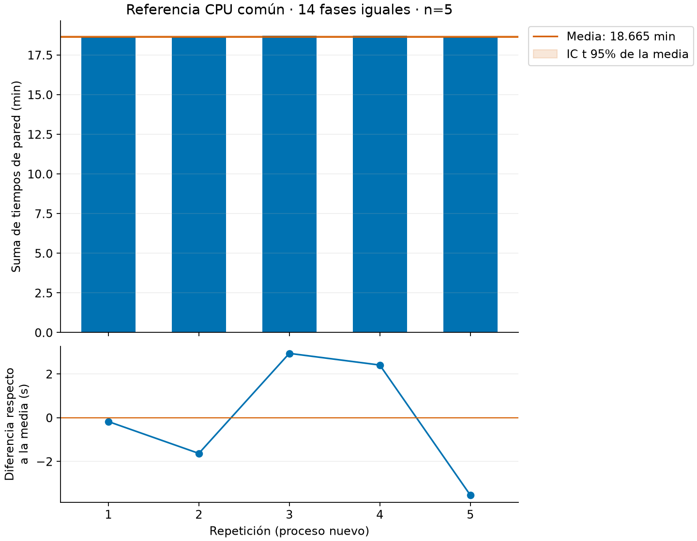
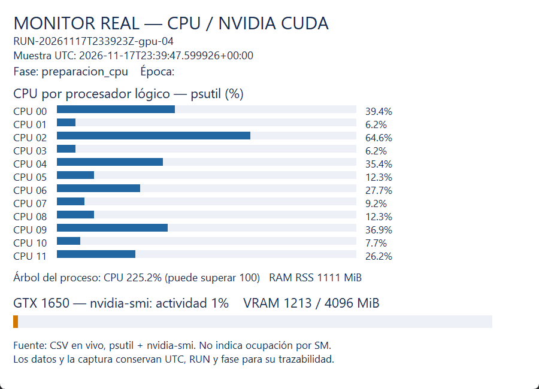
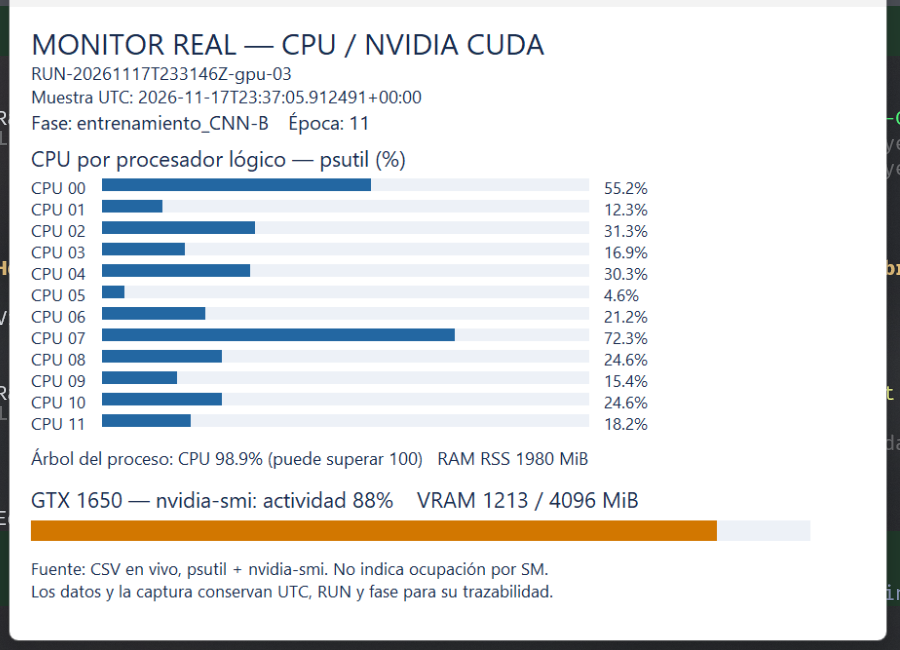
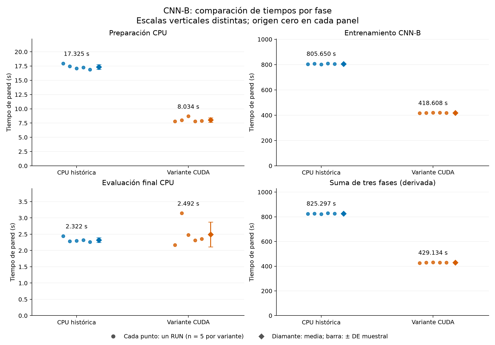
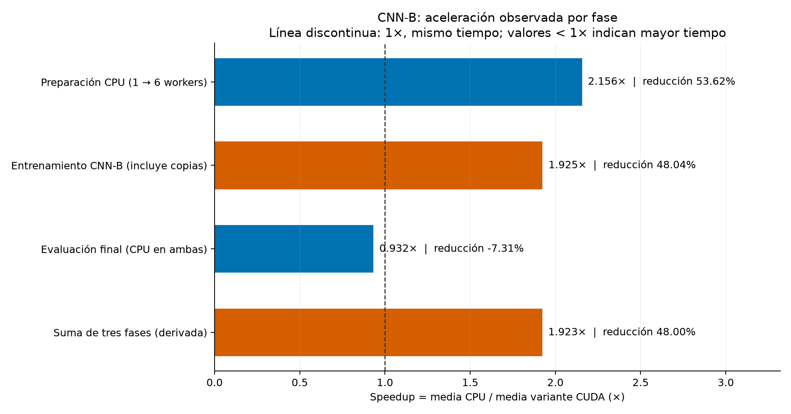
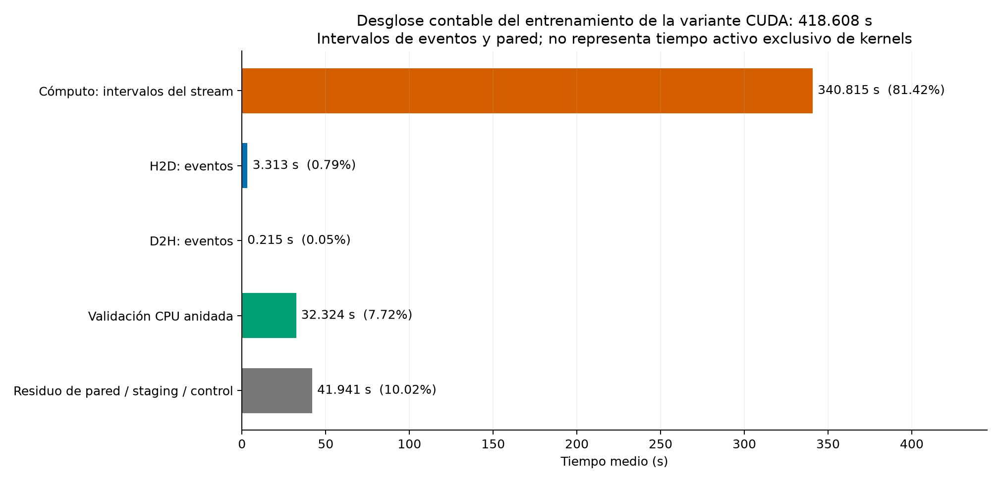
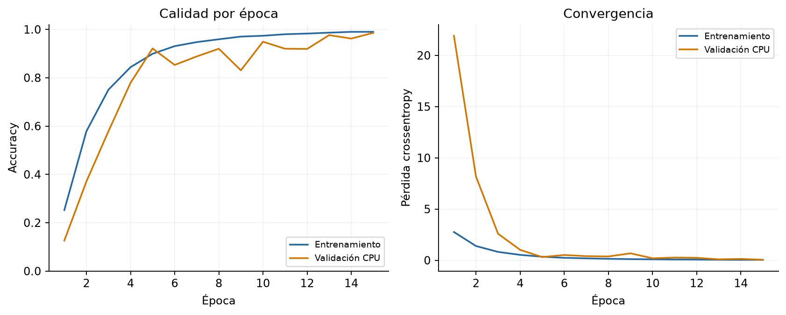

# Proyecto 3: Mejorando algoritmos con CUDA

UNIVERSIDAD DEL VALLE DE GUATEMALA

Facultad de Ingeniería · Departamento de Ciencias de la Computación

CC3069 · Computación Paralela y Distribuida · Semestre II, 2026

Proyecto 3
Mejorando algoritmos
con CUDA

Informe de rendimiento y análisis
Reconocimiento de señas ASL con CNN-B

David Domínguez · 23712
Jonathan Diaz · 23873
Luis Padilla · 23663

Guatemala, noviembre de 2026

### Resumen

Se analizó el laboratorio de reconocimiento ASL y se seleccionó CNN-B como principal oportunidad de aceleración. Se mantuvo la preparación de archivos en CPU y se implementó la matemática del entrenamiento con CUDA Python, kernels Numba-CUDA y cuBLAS. Se compararon cinco ejecuciones CPU y cinco GPU con las mismas 17,400 imágenes, arquitectura, pesos iniciales y 15 épocas, incluyendo transferencias y validación CPU en el tiempo de entrenamiento.

**Tabla 1. Resultado principal del entrenamiento CNN-B**

| CPU, media ± DE | Variante CUDA, media ± DE | Speedup | Reducción |
| --- | --- | --- | --- |
| 805.650 ± 2.723 s | 418.608 ± 1.916 s | 1.9246× | 48.04% |

La comparación utiliza una referencia CPU histórica: el orden y las máscaras aleatorias no son idénticos entre backends. El resultado acredita una reducción local del tiempo de CNN-B, no del laboratorio completo. Las capturas demuestran uso real de CPU y GPU; no demuestran saturación total de memoria ni ocupación por multiprocesador. La exactitud de prueba GPU fue 98.62%.

Palabras clave: CUDA Python, ASL, CNN, CPU/GPU, transferencias, speedup.


<!-- Salto de página -->

## 1. Análisis de la solución secuencial existente

El programa clasifica imágenes almacenadas de manos en 29 clases: A–Z, del, nothing y space. Sus partes principales son adquisición/exploración, preparación, entrenamiento, evaluación y selección, y predicción sobre fotografías propias. El laboratorio procesa archivos, no vídeo en vivo.

**Tabla 2. Descomposición del recorrido original**

| No. | Operación identificada | Descripción de su funcionamiento |
| --- | --- | --- |
| 1 | Configuración y recepción | Importar librerías, recuperar ASL Alphabet de caché e identificar 29 clases. |
| 2 | Exploración e inventario | Contar 87,000 imágenes disponibles e inspeccionar formato y muestras. |
| 3 | Muestreo y partición | Seleccionar 600 imágenes/clase; separar train/val/test 70/15/15 con semilla 42. |
| 4 | Preparación | Abrir JPEG, convertir RGB, redimensionar a 64×64 y normalizar float32/255; codificar etiquetas. |
| 5 | Persistencia de datos | Conservar arreglos preparados y el mapeo clase–índice; revisar transformación visual. |
| 6 | Entrenamiento CNN | Construir CNN-A y CNN-B; ejecutar forward, pérdida, backward, Adam y validación. |
| 7 | Diagnóstico CNN | Calcular accuracy/loss, predicciones, matriz de confusión y reporte de clasificación. |
| 8 | Otras alternativas | Entrenar FC-A/FC-B; ajustar PCA de 150 componentes y dos Random Forest. |
| 9 | Aumento de imágenes | Entrenar una nueva CNN seleccionada con rotación, zoom, traslación y contraste. |
| 10 | Selección y guardado | Comparar métricas, elegir modelo final, guardar y recargar redes y estimadores. |
| 11 | Fotografías propias | Preparar 15 imágenes del equipo y obtener etiquetas mediante predict y argmax. |
| 12 | Presentación | Mostrar predicciones y aciertos; comparar modelos y discutir generalización. |

**Tabla 3. Operaciones repetitivas**

| Operación repetitiva | Datos que procesa | Cantidad de repeticiones |
| --- | --- | --- |
| Leer/RGB/resize | Archivos seleccionados | 17,400 por carga completa, no por época. |
| Normalizar y etiquetar | 12,288 valores por imagen | 213,811,200 valores y 17,400 etiquetas por carga. |
| Forward/backward/Adam | Lotes, pesos y gradientes | 96 pasos/época; 95 lotes de 128 y uno de 20. |
| Entrenar modelos | Train: 12,180 imágenes | 5 fit originales; hasta 15 épocas por modelo. |
| Validar | Val: 2,610 imágenes | Una pasada por época y por red. |
| Capas convolucionales | Mapas y filtros 3×3 | 2 capas/lote CNN-A; 5 capas/lote CNN-B. |
| Ajustar PCA / bosques | Vectores y 150 componentes | 1 ajustePCA; 2 bosques,100+300 árboles. |
| Inferir fotos propias | 15 fotografías,6 modelos | 15 predicciones finales y 90 al comparar modelos. |

Los niveles anteriores están anidados y no se suman. En el historial original CNN-B terminó en 11 épocas por parada temprana; la medición controlada posterior usa 15 épocas fijas en ambas variantes. “Secuencial” designa la versión CPU: sus librerías pueden usar varios hilos.


<!-- Salto de página -->

## 2. Medición del tiempo de ejecución secuencial

### Datos, entorno y condiciones controladas

Se reutilizó ASL Alphabet, versión local 1, sin descargar otra vez (Akash, s. f.). De 87,000 imágenes se conservaron 17,400: 12,180 de entrenamiento, 2,610 de validación y 2,610 de prueba. No se detectaron duplicados exactos entre las particiones. SHA-256 de archivos, etiquetas y tensores permitió comprobar que la carga CPU/GPU coincidía. Esto no acredita independencia por persona o sesión.

**Tabla 4. Entorno utilizado**

| Componente | Configuración registrada |
| --- | --- |
| CPU y RAM | AMD Ryzen 5 4600 H; 6 núcleos físicos/12 lógicos; 15.42 GiB RAM. |
| Entorno | Windows; PCUDA; Python 3.14.3; NumPy 2.5.5; TensorFlow 2.22.0 rc 0. |
| Paralelismo CPU | TensorFlow intra-op 6/inter-op 1; BLAS6; RandomForest n_jobs=−1. |
| Preparación base | Un worker; Pillow RGB/resize BICUBIC; 64×64; float32/255. |
| Entrenamiento base | 15 épocas fijas; batch 128; sin EarlyStopping ni restauración de mejor época. |

### Procedimiento de medición

Cada repetición se ejecutó en un proceso nuevo: verificar identidades, construir/calentar modelos, restaurar pesos y optimizador, cargar imágenes y medir las fases con perf_counter_ns. La validación dentro de fit está incluida. Se excluyeron imports, calentamiento, EDA, gráficas y escritura final de checkpoints. La caché del sistema no se vació y los archivos se verificaron antes de medir; no se trata de disco frío. Se conservaron todas las observaciones completas.

**Tabla 5. Cinco repeticiones CPU: alcances distintos expresados en segundos**

| Repetición | Referencia común
14 fases | CNN-B fit | Pipeline adaptativo |
| --- | --- | --- | --- |
| C1 | 1119.751 | 803.847 | 2011.095 |
| C2 | 1118.294 | 806.870 | 2002.552 |
| C3 | 1122.869 | 802.320 | 2001.774 |
| C4 | 1122.335 | 809.363 | 1296.610 |
| C5 | 1116.389 | 805.848 | 1981.052 |

La referencia común promedió 1119.928±2.723 s (media±DE). El pipeline adaptativo promedió 1858.617±314.366 s, pero cambió de CNN aumentada en C04: es un promedio descriptivo de ramas diferentes, no una base homogénea para speedup. CNN-B base se ejecutó en las cinco corridas y su fit de 805.650±2.723 s es la referencia compatible empleada después.


<!-- Salto de página -->

### 2.1 Resultados CPU por fase y factores de rendimiento

**Tabla 6. Distribución de las 14 fases comunes CPU (n=5)**

| Grupo de fases | Suma de medias (s) |
| --- | --- |
| Preparación | 17.325 |
| CNN-A: fit + test | 125.641 |
| CNN-B: fit + test | 807.972 |
| FC-A: fit + test | 51.095 |
| FC-B: fit + test | 102.961 |
| PCA | 3.963 |
| RF-A: fit + validación | 2.806 |
| RF-B: fit + validación | 8.164 |



CNN-B fit representa 71.94% de los 1119.928 s comunes. La variación común fue pequeña (CV0.243%; IC t 95%[1116.546,1123.309]s); el total adaptativo tuvo CV16.91% por cambiar de rama. También pueden influir caché, hilos internos, cargas del sistema y estado térmico. No se aisló experimentalmente el efecto individual de esos factores.


<!-- Salto de página -->

## 3. Identificación de oportunidades de paralelización

Se priorizó la matemática del entrenamiento de CNN-B por su predominio temporal y el gran número de operaciones regulares sobre lotes y mapas de características. No se eligió la arquitectura por obtener mejor test en una nueva búsqueda; se fijó por prioridad computacional.

**Tabla 7. Operaciones seleccionadas y justificación**

| Operación | Simultaneidad aprovechable | Beneficio esperado |
| --- | --- | --- |
| Convolución forward | Salidas por imagen, píxel y filtro. | Distribuir muchos productos y sumas. |
| Gradientes convolucionales | Contribuciones de posiciones/lotes y filtros. | Acelerar el trabajo repetido del backward. |
| Capas Dense | Elementos de productos matriciales. | Usar multiplicación matricial especializada. |
| ReLU y Dropout | Transformación independiente por elemento. | Procesar activaciones/gradientes simultáneamente. |
| MaxPooling | Ventanas y canales independientes. | Reducir ventanas en paralelo y conservar índice de máximo. |
| BatchNormalization | Agregaciones por canal y aplicación por elemento. | Paralelizar estadísticas y transformación. |
| Softmax y pérdida | Filas del lote y clases dentro de cada fila. | Reducir máximos/sumas y calcular gradiente estable. |
| Adam | Actualización por parámetro una vez listo el gradiente. | Actualizar millones de parámetros con trabajo uniforme. |

### Operaciones que permanecieron en CPU

Apertura y decodificación de JPEG, conversión RGB, resize, normalización de entrada, etiquetado, organización de lotes, máscaras aleatorias, validación, test, métricas de informe y persistencia. La preparación permite concurrencia entre archivos sin alterar los tensores. PCA, Random Forest, otras redes y las fotografías propias no se trasladaron a GPU en este alcance.

### Dependencias que limitan el paralelismo

Las capas necesitan las activaciones anteriores. La pérdida precede al backward y Adam requiere los gradientes completos antes de actualizar pesos. El siguiente lote usa esos pesos nuevos; por ello no se entrenan épocas independientemente. BatchNormalization y gradientes necesitan reducciones: la independencia por muestra no elimina las agregaciones.

La oportunidad era una hipótesis de rendimiento en esta etapa. La selección no garantizaba un speedup mínimo ni que cada operación pequeña fuera más rápida en GPU de manera aislada.


<!-- Salto de página -->

## 4. Diseño del algoritmo paralelo

El flujo diseñado separa CPU (preparación) → H2 D → GPU (entrenamiento) → D2 H → CPU (validación/test). Se usa un proceso, una GPU y un stream, sin solapamiento. Los estados del modelo permanecen en GPU durante entrenamiento; cada época exporta pesos/BN para validar en CPU.

Arquitectura: Conv 32–ReLU–BN → Conv 32–ReLU–Pool–Dropout 0.25 → Conv 64–ReLU–BN → Conv 64–ReLU–Pool–Dropout 0.25 → Conv 128–ReLU–BN–Pool–Dropout 0.30 → Flatten 8192 → Dense 256–ReLU–BN–Dropout 0.40 → Dense 29–Softmax. Hay 2,245,245 parámetros entrenables y 960 valores móviles BN. El orden Conv→ReLU→BN se conserva.

**Tabla 8. Distribución efectiva de trabajo entre threads, blocks y grids**

| Operación | Block | Grid / asignación |
| --- | --- | --- |
| im2col/col2im, activaciones, pooling, Dropout, Adam, control de finitud | 256 threads | min (4096, ceil (E/256)); recorrido grid-stride. |
| Reducción por canal BN/bias | 32×8=256 | (ceil (L/2048), ceil (C/32)); canales contiguos por warp. |
| Fusión de parciales por canal | 256 threads | C blocks; reducción de parciales y estadísticas. |
| Softmax/pérdida | 32 threads | b blocks: una fila/imagen por block; 29 clases útiles. |
| Métricas / contador | 256 /1 | Un block; agregación del lote / avance de paso. |
| Productos grandes SGEMM | Backend NVIDIA | cuBLAS administra su jerarquía interna; no se atribuyen grids propios. |

E=número de elementos; L=filas reducidas; C=canales; b=128 o 20. Numba-CUDA permite declarar esta jerarquía explícitamente al lanzar los kernels (NVIDIA, s. f.-c). Para una convolución se organiza im2col, SGEMM y gather backward; la biblioteca cuBLAS implementa álgebra lineal sobre memoria GPU (NVIDIA, s. f.-a). No se confunde im2col con leer o preparar archivos JPEG.

### Secuencia, memoria y decisiones del diseño

Por lote: copiar datos/máscaras; ejecutar forward y pérdida; calcular backward; actualizar todos los parámetros con Adam; verificar finitud. Tras 96 lotes, exportar modelo y validar. Se conservan b real en la pérdida, padding SAME, MaxPool 2×2, BN (momentum 0.9, epsilon 0.001), Adam (lr 0.001, beta 0.9/0.999, epsilon 1e−7) y precisión FP32 sin mixed precision/TF32.

Workspace im2col reutilizable 576 MiB; tope previsto 1408 MiB. La reserva real de buffers propios fue 1,207,125,096 bytes (aprox. 1151.2 MiB), dentro del límite. El diseño tiled 16×16 se conservó como referencia; antes de congelar las corridas se eligió SGEMM por admisión preliminar≈0.60 frente a≈0.26 s/lote (n=1, no resultado final). Se reutilizó CPU histórica compatible; no se impuso una campaña nueva ni igualdad de máscaras de backends distintos.


<!-- Salto de página -->

## 5. Implementación con CUDA Python

Se conservó el notebook original y se creó una copia documentada con el flujo CUDA y salidas reales de la última corrida. Los kernels propios se implementaron con numba-cuda 0.30.4 (Numba 0.67.0); SGEMM usa cuBLAS mediante ctypes sobre los mismos buffers y stream. La GPU fue GTX 1650, compute capability 7.5, driver 591.59 y toolkit CUDA 13.1. TensorFlow es una compilación CPU y se usa solo como referencia, validación/test y persistencia.

La preparación utiliza ThreadPoolExecutor con 6 workers y hasta 12 tareas pendientes. Un coordinador conserva el orden; los SHA-256 de X/y coincidieron con CPU. Se mantuvieron datos, pesos iniciales,15 épocas, batch 128 y 1440 actualizaciones. Seed 43; shuffle PCG64 y máscaras Bernoulli con probabilidades originales. No reproducen exactamente el RNG de TensorFlow histórico.

### Ejecución y temporización

Cada prueba fue un proceso nuevo. Se calentaron 128+20 muestras train,128 val y 32 test y se verificó la restauración de pesos, Adam, BN y contador. El cronómetro de pared sincronizado incluye staging, máscaras, H2 D, cómputo, D2 H y validación CPU por época. Los eventos CUDA se registran por grupo; no sustituyen la pared ni son tiempo activo puro de kernels.

**Tabla 9. Cinco ejecuciones CUDA completas: segundos y test real**

| RUN | Preparación CPU | Entrenamiento | Test CPU | Accuracy test |
| --- | --- | --- | --- | --- |
| G01 | 7.785 | 415.499 | 2.169 | 98.621% |
| G02 | 8.003 | 418.797 | 3.145 | 98.621% |
| G03 | 8.693 | 420.509 | 2.478 | 98.621% |
| G04 | 7.786 | 419.772 | 2.314 | 98.621% |
| G05 | 7.905 | 418.461 | 2.355 | 98.621% |

Media de entrenamiento 418.608±1.916 s; CV0.458%; IC t 95% nominal[416.228,420.987]s. El semiancho relativo 0.568% cumple el criterio previo≤5%; no fue necesario ampliar a 7/9 repeticiones. No se excluyeron corridas completas por ser lentas o por su accuracy.

### Comprobaciones de corrección y evidencias conservadas

Aprobaron 51 pruebas de operadores,78 comparaciones de adjuntos locales con activaciones idénticas y 10 pasos sintéticos de integración, contador y guardado/recarga. Se conservaron diagnósticos estrictos de red completa fallidos: se observaron cambios de rutas MaxPooling cerca de empates FP32. Las pruebas locales respaldan la implementación; no certifican igualdad global bit a bit ni corrección absoluta por obtener alta accuracy.

Las cinco corridas terminaron con código 0 y contador Adam 1440. Los checkpoints tienen contenido numérico canónico idéntico en este entorno. El monitoreo por segundo registró CPU por procesador lógico, GPU, VRAM, temperatura y fase. Los apartados siguientes presentan las capturas originales y extractos de logs; no son simulaciones del rendimiento.


<!-- Salto de página -->

### 5.1 Evidencia de ejecución: preparación en CPU

Captura de la ventana real del monitor alimentado por psutil y nvidia-smi durante la cuarta ejecución CUDA. Muestra CPU por 12 procesadores lógicos y baja actividad GPU mientras la CPU prepara las imágenes. La muestra corresponde al 17/11/2026,23:39:47 UTC.



Un porcentaje de proceso superior a 100% resulta de sumar actividad de varios hilos; no significa más de 100% de un solo núcleo. Las barras por procesador son actividad del sistema y no atribución exclusiva del proyecto. Seis workers estaban configurados. La captura pertenece a preparación CPU de la variante optimizada; no es una captura del fit CPU histórico.

#### Registro real de la referencia CPU

```text
CPU: AMD Ryzen 5 4600H; 6 físicos / 12 lógicos
TensorFlow: is_cuda_build=false; dispositivo efectivo CPU:0
TensorFlow intra-op=6, inter-op=1; BLAS=6
```

```text
RESULTADO preparacion_cpu: 17.963012 s
RESULTADO entrenamiento_CNN-B: 803.847403 s
RESULTADO evaluacion_CNN-B: 2.444951 s
```

Extractos literales del log de C01: preparación 17.963012 s, fit CNN-B 803.847403 s y evaluación 2.444951 s. El hardware efectivo CPU y los registros por procesador respaldan la ejecución base. No se fabricó una captura retroactiva de ese entrenamiento.


<!-- Salto de página -->

### 5.2 Evidencia de ejecución: entrenamiento en GPU

El dispositivo se reconoció como NVIDIA GeForce GTX 1650 con 4096 MiB, compute capability 7.5 y simulador desactivado. La siguiente captura fue tomada durante entrenamiento CNN-B, época 11, de la tercera repetición; no corresponde a reposo ni a una nueva ejecución.



**Tabla 10. Monitoreo de entrenamiento GPU por repetición**

| RUN | Actividad media | Máxima | VRAM máxima | T máxima |
| --- | --- | --- | --- | --- |
| G01 | 87.29% | 91% | 1213 MiB | 69°C |
| G02 | 87.69% | 93% | 1213 MiB | 69°C |
| G03 | 85.98% | 92% | 1213 MiB | 70°C |
| G04 | 87.96% | 92% | 1213 MiB | 70°C |
| G05 | 86.84% | 94% | 1213 MiB | 69°C |

La actividad alta demuestra uso GPU; 1213 MiB equivale a 29.6% de capacidad VRAM, por lo que no demuestra saturación total. Actividad agregada y ocupación por SM son métricas diferentes; la segunda no se midió. nvidia-smi permite registrar métricas de monitorización, cuya interpretación debe respetar su definición (NVIDIA, s. f.-b).

```text
2026-11-17T23:54:28.818359+00:00 evaluacion_final_cpu {'pasos': 1440}
2026-11-17T23:54:31.360894+00:00 completada {'pasos': 1440}
```

Log literal deG05: tras 1440 pasos se evalúa en CPU y termina la corrida. Los cinco procesos registran salida 0. Las capturas y los logs documentan fases diferentes y complementarias; no se presentan como mediciones simultáneas de una única corrida.


<!-- Salto de página -->

## 6. Análisis y conclusiones

**Tabla 11. Comparación de fases equivalentes, n=5 por variante**

| Fase | CPU media (s) | Variante CUDA (s) | Speedup | Reducción |
| --- | --- | --- | --- | --- |
| Preparación CPU | 17.325 | 8.034 | 2.1563× | 53.62% |
| Entrenamiento CNN-B | 805.650 | 418.608 | 1.9246× | 48.04% |
| Evaluación final CPU | 2.322 | 2.492 | 0.9319× | -7.31% |
| Suma de tres fases | 825.297 | 429.134 | 1.9232× | 48.00% |

S=media CPU/media CUDA; ahorro=media CPU−media CUDA; reducción (%)=100× (1−media CUDA/media CPU). Se calcula un cociente de medias, no una media de cocientes de corridas emparejadas artificialmente.

Entrenamiento: S=805.6497257/418.6076830=1.924593739×. El ahorro es 387.042 s (6.451 min), una reducción 48.041%. Se pasa de 13.427 a 6.977 min incluyendo copias y validación. Un speedup 1.925× no significa 192.5% menos tiempo.



CPU/GPU: DE entrenamiento 2.723/1.916 s y CV0.338/0.458%. Incluso el máximo GPU es menor que el mínimo CPU. Esto respalda estabilidad local, sin eliminar sesgos temporales/térmicos. Los IC t 95% de medias son nominales y no son intervalos del speedup.


<!-- Salto de página -->

### 6.1 Speedup por fase y discusión técnica



#### ¿Por qué procesar imágenes/archivos con varios núcleos CPU y delegar la matemática a GPU?

Los archivos requieren acceso al almacenamiento, decodificación JPEG y transformaciones de entrada. El paralelismo entre archivos permite usar 6 workers CPU con orden fijo; en esta prueba la preparación bajó 17.325→8.034 s sin cambiar los tensores. Esa mejora 2.156× pertenece a CPU. Después, las convoluciones y productos densos tienen muchas operaciones regulares sobre lotes, adecuadas para distribuir entre hilos GPU y una biblioteca matricial especializada. Mantener archivos en CPU y matemática de entrenamiento en GPU coincide con ese reparto observado; no demuestra que toda preparación posible sea siempre más rápida en CPU.

#### ¿Cómo CUDA permitió reducir o cambiar el tiempo de procesamiento?

Numba-CUDA distribuye im2col/col2im, activaciones, pooling, BN, Dropout, pérdida y Adam; cuBLAS realiza SGEMM con buffers GPU y el mismo stream. Reutilizar memoria evita reservarla en cada operación. La combinación reduce el fit a 418.608 s frente a 805.650 s CPU, aun contandoH2 D/D2 H y validación CPU. La suma de preparación, fit y test baja 825.297→429.134 s: 1.9232× y 48.00% menos tiempo. Ese total incluye también la mejora CPU y no equivale a todo el notebook original.

La referencia CPU usa librerías con varios hilos; la comparación incluye cambios de backend y orquestación. Los datos no permiten atribuir un porcentaje causal preciso a cada kernel, al hardware aislado o a la reutilización de buffers.


<!-- Salto de página -->

### 6.2 Transferencias y factores que limitan CUDA



**Tabla 12. Componentes incluidos en 418.608 s medios de entrenamiento**

| Componente | Media (s) | Parte del total |
| --- | --- | --- |
| Cómputo: intervalos del stream | 340.815 | 81.416% |
| H2 D: eventos | 3.313 | 0.791% |
| D2 H: eventos | 0.215 | 0.051% |
| Validación CPU anidada | 32.324 | 7.722% |
| Residuo de pared / staging / control | 41.941 | 10.019% |

#### ¿Qué factores justifican o limitan la utilización de CUDA?

La justifican el volumen de convoluciones/productos matriciales,1440 actualizaciones y el dominio temporal de CNN-B. La limitan transferencias, staging, generación CPU de máscaras, llamadas y sincronización Host, exportación por época, validación CPU, dependencias entre capas/pasos y memoria disponible. H2 D+D2 H suman 3.528 s (0.843% de la pared); validación CPU y residuo suman 74.265 s (17.741%). No se suman otra vez al entrenamiento.

Los eventos pueden contener huecos de envío Host; el residuo no es una fase perfilada exclusivamente de Python. Por eso no se infiere un límite formal de Amdahl, ocupación SM ni ancho de banda PCIe. No hay speedup de transferencias porque CPU histórica no tiene una fase equivalente medida. El test CPU subió 0.170 s de media; su corta duración y mayor variabilidad impiden asegurar una regresión general.


<!-- Salto de página -->

### 6.3 Calidad, conclusiones y alcance de los resultados



Test GPU: 98.620689% (2574/2610 aciertos), loss 0.061565; validación final 98.582375%. CPU histórica CNN-B: 92.874–98.889%. No se concluye mejora de calidad por usar GPU ni equivalencia de trayectorias. La prueba usa el test interno, no vídeo, test oficial de 28 imágenes ni fotos propias. No hay separación acreditada por persona/sesión.

El entrenamiento CNN-B se aceleró 1.9246× y redujo 48.04% su tiempo, incluyendo copias y validación.

El reparto CPU/GPU permitió reducir la suma comparable 48.00%; la mejora de preparación es CPU y el test no mejoró.

Paralelismo tensorial y SGEMM especializado son explicaciones coherentes con código y tiempos; su contribución individual no se aisló.

Los resultados son locales: CPU histórica no alternada, RNG/shuffle distintos y condiciones térmicas no igualadas. No se certifica generalización a otro hardware.

Uso GPU y fin correcto están documentados; no se certifican saturación literal, ocupación por SM ni igualdad global bit a bit. Se conservaron pruebas fallidas y límites.

### Referencias

Akash. (s. f.). ASL alphabet [Conjunto de datos]. Kaggle. https://www.kaggle.com/datasets/grassknoted/asl-alphabet

NVIDIA. (s. f.-a). cuBLAS library (CUDA Toolkit 13.1) [Documentación]. https://docs.nvidia.com/cuda/archive/13.1.0/cublas/index.html

NVIDIA. (s. f.-b). NVIDIA System Management Interface [Documentación]. Recuperado el 17 de noviembre de 2026, de https://docs.nvidia.com/deploy/nvidia-smi/index.html

NVIDIA. (s. f.-c). Writing CUDA kernels. En Numba CUDA. Recuperado el 17 de noviembre de 2026, de https://nvidia.github.io/numba-cuda/user/kernels.html
