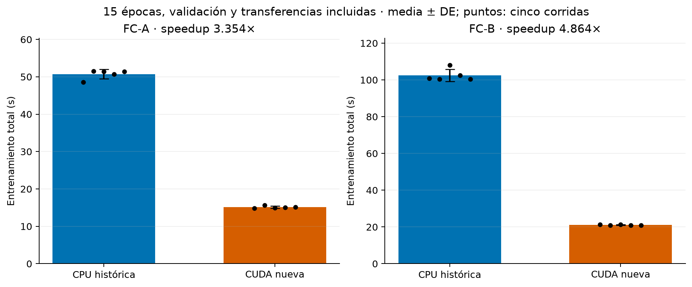
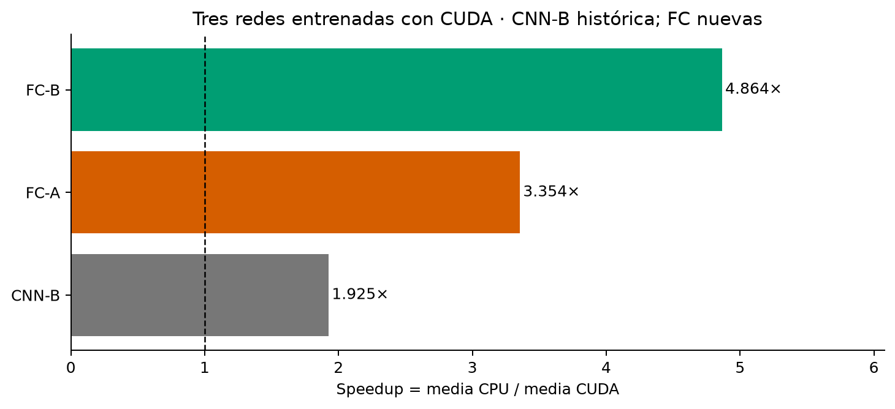
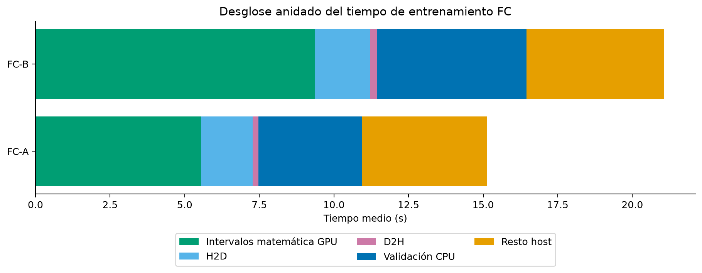
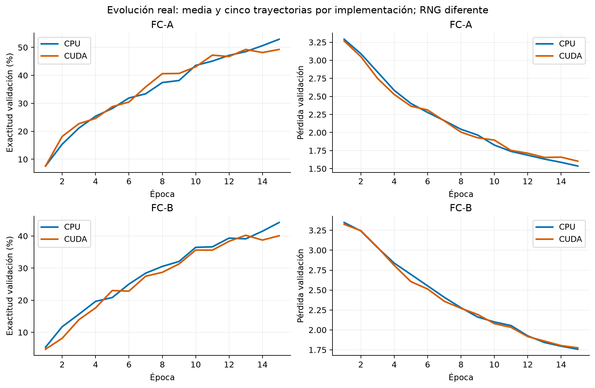

# Ampliación FC-A/FC-B: implementación y resultados reales

EXP-012, DEC-027, CAM-012. Cinco RUN nuevos por red; 150 épocas y14,400 actualizaciones nuevas en total. No se repitió entrenamiento CPU ni CNN-B. Comparación histórica contra cinco RUN CPU EXP-002; CNN-B se reutiliza de EXP-003. Responsable de ejecución: Codex por solicitud del usuario.

## Procedimiento aplicado y equivalencia

PCUDA existente, GTX1650sm75 de4GiB, CUDA13.1, Numba-CUDA/cuBLAS SGEMM FP32 PEDANTIC; sin TF32 ni mixed precision. Preparación de imágenes en CPU con6workers. Mismo manifiesto17,400imágenes,12180/2610/2610, RGB64×64 /255. Tensores verificados SHA-256 contra CPU en cada RUN; inicializaciones FC completas restauradas del primer RUN CPU histórico (incluyendo Adam). FC-A [128,64],Dropout0.3,semilla44; FC-B [512,256,128],Dropout0.4,semilla45; BN de entrada12,288features,momentum0.99,epsilon0.001.

Warmup por RUN: lotes128+20GPU,128validaciónCPU y32testCPU; restauración completa verificada. Quince épocas fijas,96lotes/época,1440actualizaciones,último lote20,validaciónCPU128cadaépoca ytestCPU32. Tiempo principal pared sincronizada con H2D/D2H,staging,máscaras yvalidación incluidos; compilación,inicialización,gráficas yguardado fuera. RNG PCG64 reproducible en GPU; no son las mismas máscaras ni orden interno CPU. Se reutiliza la referencia histórica por instrucción del usuario. No se afirma comparación alternada/pareada ni identidad de trayectoria de aprendizaje.

## Tiempos y speedup por fase

Speedup = media CPU / media CUDA. Reducción = (1−mediaCUDA/mediaCPU)×100. Evaluación final sigue en CPU: su razón no mide inferencia GPU.

| modelo | fase | cpu_media_s | cpu_de_s | cuda_media_s | cuda_de_s | speedup | reduccion_pct |
| --- | --- | --- | --- | --- | --- | --- | --- |
| CNN-B | entrenamiento_CNN-B | 805.649726 | 2.722684 | 418.607683 | 1.916308 | 1.924594 | 48.040982 |
| CNN-B | evaluacion_CNN-B | 2.322390 | 0.071787 | 2.492192 | 0.381288 | 0.931866 | -7.311550 |
| FC-A | entrenamiento_FC-A | 50.715660 | 1.264624 | 15.122541 | 0.332283 | 3.353647 | 70.181712 |
| FC-A | evaluacion_FC-A | 0.378842 | 0.005733 | 0.392414 | 0.004507 | 0.965414 | -3.582510 |
| FC-B | entrenamiento_FC-B | 102.441082 | 3.275205 | 21.061995 | 0.201404 | 4.863788 | 79.439895 |
| FC-B | evaluacion_FC-B | 0.520067 | 0.011493 | 0.523174 | 0.008612 | 0.994060 | -0.597535 |

Las tres fases de entrenamiento seleccionadas suman 958.806468sCPU y454.792219sCUDA: cociente agregado 2.108230×. Es suma de medias de fases compatibles medidas en campañas distintas, **no** una ejecución continua del pipeline completo. No sumar speedups individuales ni extrapolar al total adaptativo original.

## Dispersión de las mediciones

| modelo | fase | origen | n | media_s | de_s | cv_pct | ic95_inf_s | ic95_sup_s | min_s | max_s |
| --- | --- | --- | --- | --- | --- | --- | --- | --- | --- | --- |
| CNN-B | entrenamiento_CNN-B | CPU | 5 | 805.649726 | 2.722684 | 0.337949 | 802.269067 | 809.030384 | 802.320202 | 809.363247 |
| CNN-B | entrenamiento_CNN-B | CUDA | 5 | 418.607683 | 1.916308 | 0.457781 | 416.228272 | 420.987094 | 415.499294 | 420.508824 |
| CNN-B | evaluacion_CNN-B | CPU | 5 | 2.322390 | 0.071787 | 3.091103 | 2.233254 | 2.411526 | 2.265277 | 2.444951 |
| CNN-B | evaluacion_CNN-B | CUDA | 5 | 2.492192 | 0.381288 | 15.299306 | 2.018761 | 2.965624 | 2.168861 | 3.144971 |
| FC-A | entrenamiento_FC-A | CPU | 5 | 50.715660 | 1.264624 | 2.493557 | 49.145422 | 52.285898 | 48.520110 | 51.495011 |
| FC-A | entrenamiento_FC-A | CUDA | 5 | 15.122541 | 0.332283 | 2.197270 | 14.709957 | 15.535125 | 14.829318 | 15.685816 |
| FC-A | evaluacion_FC-A | CPU | 5 | 0.378842 | 0.005733 | 1.513176 | 0.371724 | 0.385960 | 0.372953 | 0.388350 |
| FC-A | evaluacion_FC-A | CUDA | 5 | 0.392414 | 0.004507 | 1.148503 | 0.386818 | 0.398010 | 0.387394 | 0.397907 |
| FC-B | entrenamiento_FC-B | CPU | 5 | 102.441082 | 3.275205 | 3.197159 | 98.374378 | 106.507786 | 100.347325 | 108.090014 |
| FC-B | entrenamiento_FC-B | CUDA | 5 | 21.061995 | 0.201404 | 0.956246 | 20.811918 | 21.312071 | 20.851751 | 21.302664 |
| FC-B | evaluacion_FC-B | CPU | 5 | 0.520067 | 0.011493 | 2.209969 | 0.505796 | 0.534337 | 0.509861 | 0.537079 |
| FC-B | evaluacion_FC-B | CUDA | 5 | 0.523174 | 0.008612 | 1.646092 | 0.512481 | 0.533867 | 0.511014 | 0.531258 |

DE muestral; IC95 nominal Student t con4grados de libertad. Repeticiones deterministas en el mismo equipo no muestrean todas las condiciones de otro hardware o sesión.

## Desglose y causas

| modelo | pared_s | validacion_cpu_s | h2d_eventos_s | d2h_eventos_s | matematica_intervalos_stream_s | resto_host_s |
| --- | --- | --- | --- | --- | --- | --- |
| FC-A | 15.122541 | 3.481379 | 1.733154 | 0.185665 | 5.548887 | 4.173457 |
| FC-B | 21.061995 | 5.008333 | 1.863861 | 0.222636 | 9.356508 | 4.610657 |

Los eventos son intervalos de un único stream y pueden contener huecos de envío del host; no prueban tiempo activo exclusivo por kernel. Validación CPU y transferencias consumen tiempo aunque las matrices entren en VRAM. Redes densas con lotes pequeños tienen menos trabajo por lanzamiento que una convolución, y su aceleración puede quedar limitada por lanzamientos, sincronización por lote y copia de parámetros grandes. Esta explicación es una hipótesis compatible con los tiempos por fase; no se midió ocupación SM ni ancho de banda efectivo con profiler.

## Calidad de los modelos

| modelo | origen | n | accuracy_media_pct | accuracy_min_pct | accuracy_max_pct | loss_media |
| --- | --- | --- | --- | --- | --- | --- |
| FC-A | CPU | 5 | 53.065133 | 53.065133 | 53.065133 | 1.523044 |
| FC-A | CUDA | 5 | 51.724136 | 51.724136 | 51.724136 | 1.572327 |
| FC-B | CPU | 5 | 44.291186 | 44.291186 | 44.291186 | 1.738064 |
| FC-B | CUDA | 5 | 39.961687 | 39.961687 | 39.961687 | 1.759407 |

Calidad y rendimiento son métricas distintas. Mantener arquitectura y número de épocas no garantiza exactitud idéntica con máscaras, orden de lotes y redondeo diferentes. Las cinco repeticiones por red GPU reinician el mismo estado/RNG: su variación mide principalmente tiempo, no incertidumbre estadística del aprendizaje.

## Evidencia de hardware

| modelo | repeticion | muestras_training | gpu_media_pct | gpu_max_pct | vram_max_mib | cpu_media_pct |
| --- | --- | --- | --- | --- | --- | --- |
| FC-A | 1 | 15 | 31.466667 | 50.000000 | 111.000000 | 121.719527 |
| FC-A | 2 | 15 | 30.933333 | 33.000000 | 111.000000 | 120.477216 |
| FC-A | 3 | 15 | 30.266667 | 33.000000 | 111.000000 | 123.102817 |
| FC-A | 4 | 15 | 32.133333 | 33.000000 | 111.000000 | 122.821218 |
| FC-A | 5 | 15 | 31.733333 | 34.000000 | 111.000000 | 123.836661 |
| FC-B | 1 | 17 | 37.941176 | 56.000000 | 187.000000 | 147.502830 |
| FC-B | 2 | 16 | 40.812500 | 55.000000 | 187.000000 | 157.620959 |
| FC-B | 3 | 16 | 38.625000 | 52.000000 | 187.000000 | 146.223711 |
| FC-B | 4 | 15 | 43.266667 | 55.000000 | 187.000000 | 142.616530 |
| FC-B | 5 | 15 | 43.133333 | 53.000000 | 187.000000 | 154.109161 |

La captura original por red está en el primer RUN, junto con JSON que identifica muestra UTC y SHA-256. Es una captura real de ventana monitor en vivo alimentada por psutil/nvidia-smi; no es una gráfica presentada como captura. Datos por núcleo CPU y actividad/VRAMGPU de todos los RUN están en recursos.csv ymonitor-gpu.log. La toma de pantalla se realizó en primera repetición y su coste no se descontó; las otras cuatro conservan el muestreo sin ventana. No se afirma saturación total de VRAM ni ocupación por SM.

## Reproducción

La plantilla congelada FC_CUDA.plantilla.ipynb y el ejecutado FC_CUDA.ejecutado.ipynb contienen el código nativo por fases. Ejecutar de nuevo requiere otra identidad EXP/RUN y no sobrescribir esta campaña. scripts/resumir_ampliacion_fc.py solo lee resultados y genera tablas/gráficas; no entrena. CSVfuente,PNG/SVG y SHA-256 en fuentes.csv. Modelos grandes en data/EXP-012, referenciados por modelo-guardado.json. No se genera PDF.
