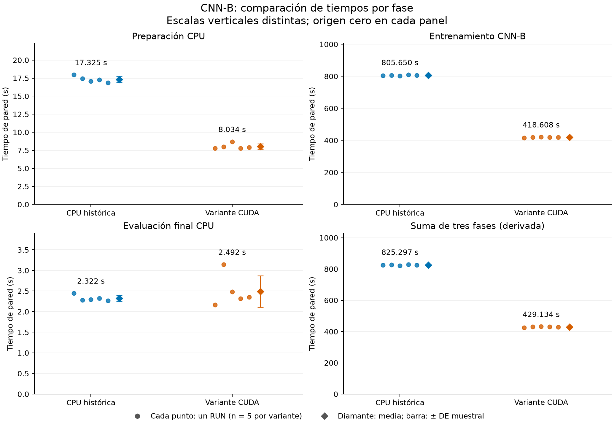
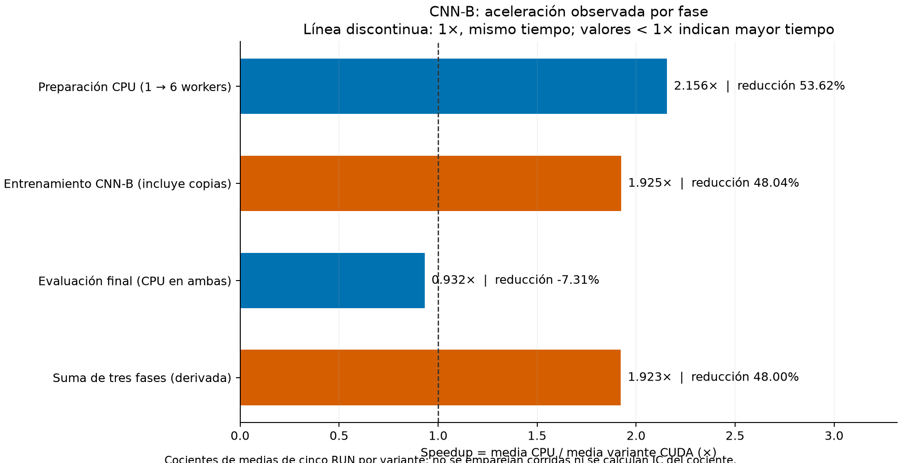
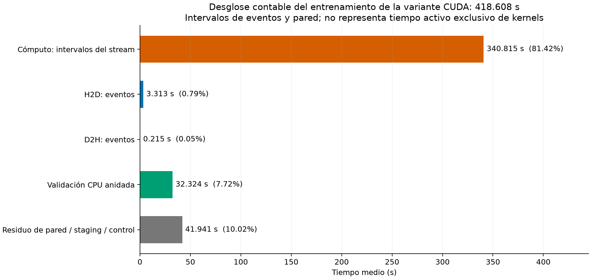

# Paso 6. Análisis y conclusiones — CNN-B CPU/CUDA

Estado: análisis del paso 6 completado para el alcance medido. **Documento de
trabajo en Markdown; no es el informe final y no se genera PDF en esta etapa.**
Responsable: Codex por solicitud del usuario. DEC-024; CAM-009; BIT-011; PROC-09.
Fuente normativa: [Proyecto 3 CUDA.pdf](../../../docs/Proyecto%203%20CUDA.pdf),
página 2, apartado 6. Elaborado a partir de cinco RUN CPU EXP-002 y cinco CUDA
EXP-003 existentes; no se entrenó ni midió el hardware nuevamente.

## 1. Alcance de la comparación

Se compara CNN-B base: 17,400 imágenes ASL, 29 clases, splits 12,180/2,610/2,610,
RGB 64×64 float32 /255, pesos iniciales preservados, Adam, 15 épocas, batch 128 y
último lote de 20; 96 lotes por época y 1440 actualizaciones. No se usa aumento
de imágenes en este alcance. Los tensores conservan las mismas identidades.

La referencia denominada secuencial es la implementación CPU original bajo el
protocolo fijo documentado; TensorFlow y BLAS usan paralelismo interno (6 hilos),
por lo que no representa un solo núcleo. La variante paralela prepara archivos
con 6 workers CPU y entrena mediante kernels Python Numba-CUDA y SGEMM cuBLAS
FP32 en una GTX 1650 de 4 GiB. Validación por época y test final permanecen CPU.

El tiempo de entrenamiento CUDA es pared sincronizada e incluye preparación de
lotes/máscaras, H2D, forward/backward/Adam, exportación D2H, validación CPU y
administración. El fit CPU también incluye validación. Imports, construcción,
warmup/restauración, EDA, figuras y guardado final quedan fuera. La suma comparable
comprende preparación + entrenamiento CNN-B + test CNN-B; no es el notebook
íntegro ni los totales CPU de 14 fases o de ramas adaptativas.

CPU es una referencia histórica no alternada con GPU. Datos, arquitectura y
volumen coinciden; RNG/shuffle no reproducen máscaras/orden exactos. Horario,
temperatura y preparación 1→6 workers difieren. Se interpreta el resultado como
aceleración observada de implementaciones con carga equivalente, sin certificar
condiciones idénticas ni aislar causalmente el efecto exclusivo del hardware.
Véase la [revisión previa](../../../docs/trazabilidad/revision-pasos-1-5.md).

## 2. Resultados individuales y comparación por fase

Cada fila es un proceso independiente; su posición no establece una pareja
experimental CPU/GPU. Se mantienen todas las cinco observaciones por variante.
La suma es derivada de tres intervalos disjuntos, no una nueva medición continua.

| Variante | RUN | Preparación (s) | Entrenamiento (s) | Test CPU (s) | Suma comparable (s) |
| --- | --- | --- | --- | --- | --- |
| CPU | RUN-20261117T171942Z-cpu-01 | 17.963 | 803.847 | 2.445 | 824.255 |
| CPU | RUN-20261117T175407Z-cpu-02 | 17.440 | 806.870 | 2.281 | 826.590 |
| CPU | RUN-20261117T182835Z-cpu-03 | 17.073 | 802.320 | 2.298 | 821.691 |
| CPU | RUN-20261117T190250Z-cpu-04 | 17.267 | 809.363 | 2.323 | 828.953 |
| CPU | RUN-20261117T192509Z-cpu-05 | 16.880 | 805.848 | 2.265 | 824.993 |
| CUDA | RUN-20261117T231628Z-gpu-01 | 7.785 | 415.499 | 2.169 | 425.453 |
| CUDA | RUN-20261117T232412Z-gpu-02 | 8.003 | 418.797 | 3.145 | 429.945 |
| CUDA | RUN-20261117T233146Z-gpu-03 | 8.693 | 420.509 | 2.478 | 431.681 |
| CUDA | RUN-20261117T233923Z-gpu-04 | 7.786 | 419.772 | 2.314 | 429.871 |
| CUDA | RUN-20261117T234658Z-gpu-05 | 7.905 | 418.461 | 2.355 | 428.721 |

**Medias y desviaciones muestrales**, n=5 por variante. Un ahorro o reducción
negativos indican que la variante CUDA tardó más en esa fase.

| Fase | CPU media ± DE (s) | Variante CUDA media ± DE (s) | Ahorro (s) | Speedup | Reducción (%) |
| --- | --- | --- | --- | --- | --- |
| Preparación CPU | 17.325 ± 0.414 | 8.034 ± 0.379 | 9.290 | 2.156306× | 53.624 |
| Entrenamiento CNN-B | 805.650 ± 2.723 | 418.608 ± 1.916 | 387.042 | 1.924594× | 48.041 |
| Evaluación final CPU | 2.322 ± 0.072 | 2.492 ± 0.381 | -0.170 | 0.931866× | -7.312 |
| Suma de tres fases | 825.297 ± 2.703 | 429.134 ± 2.313 | 396.162 | 1.923167× | 48.002 |



Figura 1. Cada punto corresponde a un RUN; diamante y barra representan media
y ±DE muestral, no IC. Cada panel tiene escala vertical propia con origen cero.
La fase de preparación es CPU en ambas variantes (1 y 6 workers), y el test
también es CPU. Fuente: [observaciones.csv](observaciones.csv) y
[estadisticas.csv](estadisticas.csv).

## 3. Cálculo e interpretación del speedup

Para cada fase se usan los valores sin redondear:

- `media = suma(tiempos de los 5 RUN) / 5`.
- `speedup S = media_CPU / media_variante_CUDA`.
- `ahorro_s = media_CPU - media_variante_CUDA`.
- `reduccion_pct = 100 × (1 - media_variante_CUDA / media_CPU)`.

Entrenamiento: `S = 805.6497257 / 418.6076830
= 1.924593739×`. El ahorro medio es **387.042 s**,
aproximadamente **6.451 minutos**, y la reducción del tiempo
es **48.041%**. Se pasa de 13.427 a
6.977 minutos para el entrenamiento completo medido.
Un speedup de 1.925× no significa 192.5% menos tiempo: corresponde a cerca de
48.04% menos tiempo. Los cocientes se calculan entre medias de grupos; no se
promedian ratios de filas emparejadas artificialmente.



Figura 2. La línea en 1× indica igualdad de tiempo. El test es 0.932×: no se
aceleró. El speedup de preparación 2.156× es una mejora CPU. El 1.923× de la suma
combina el cambio CPU de preparación con entrenamiento CUDA y test CPU; no se
atribuye por completo al dispositivo GPU. Fuente:
[comparacion_fases.csv](comparacion_fases.csv). No se calculan intervalos de
confianza del cociente ni se presentan barras de DE como si fueran esos intervalos.

La suma de tres fases baja **396.162 s (48.002%)**.
Ese ahorro es casi todo entrenamiento: su contribución al ahorro neto de la
suma es 97.70%. Este porcentaje describe
diferencias de medias, no una descomposición causal experimental.
No se calcula speedup H2D/D2H: la CPU histórica no tiene una transferencia
equivalente medida. Se informa su coste dentro del entrenamiento CUDA.

## 4. Variabilidad y suficiencia de las observaciones

| Variante | n | Mediana (s) | Mín–máx (s) | CV (%) | ICt95% nominal de la media (s) |
| --- | --- | --- | --- | --- | --- |
| CPU | 5 | 805.848 | 802.320–809.363 | 0.338 | [802.269, 809.030] |
| CUDA | 5 | 418.797 | 415.499–420.509 | 0.458 | [416.228, 420.987] |

La baja dispersión y que incluso el máximo GPU sea menor que el mínimo CPU
son consistentes con una reducción local amplia y repetible del tiempo de la
carga fijada. No se efectuó una prueba de significancia ni se atribuye toda la
diferencia a CUDA aislada del backend y demás condiciones. Los ICt95% son
nominales: `media ± 2.776445 × DE / sqrt(5)`, con 4 grados de libertad; suponen
observaciones aproximadamente independientes y error compatible con ese modelo.
No cubren sesgos térmicos, cambios temporales o de implementación.

El semiancho relativo de la media GPU es 0.568%, inferior al objetivo previo
de 5% que condicionaba ampliar a 7/9 repeticiones. Por eso cinco observaciones
son suficientes para ese criterio de precisión local. El test CPU tiene solo
unos 2–3 s y mayor variabilidad relativa en la variante CUDA; no hay evidencia
que permita atribuir su incremento a una causa concreta o asegurar una regresión
general. Todas las estadísticas adicionales están en [estadisticas.csv](estadisticas.csv).

## 5. Coste de transferencias, validación y administración

| Componente anidado | Media (s) | Porcentaje del entrenamiento |
| --- | --- | --- |
| Cómputo: intervalos del stream | 340.815 | 81.416% |
| H2D: eventos | 3.313 | 0.791% |
| D2H: eventos | 0.215 | 0.051% |
| Validación CPU anidada | 32.324 | 7.722% |
| Residuo de pared / staging / control | 41.941 | 10.019% |



Figura 3. Las cinco medias suman 418.608 s por construcción. Fuente:
[desglose_entrenamiento.csv](desglose_entrenamiento.csv). Los eventos son
intervalos del stream y pueden incluir huecos de envío Host; no equivalen a
tiempo activo puro de kernels. La última fila es un residuo calculado, no una
fase perfilada directamente ni una medida exclusiva de sobrecarga Python.

H2D+D2H suman **3.528 s**, el **0.843%** de la
pared. Están incluidos y no eliminan la mejora observada. No obstante, su pequeño
peso relativo no prueba que PCIe tenga ancho de banda óptimo ni que las copias
sean gratuitas. La implementación usa un único stream sin solapamiento y una
exportación adicional final de modelo incluida de manera conservadora.

La validación CPU ocupa 32.324 s y el residuo
41.941 s: juntos representan
17.741% de la pared. Muestran trabajo que no desaparece
al acelerar solo los productos matriciales, aunque no son una fracción serial
formal de Amdahl ni un límite inmutable: el residuo incluye varios costes y
posibles huecos Host ya contabilizados en eventos. No se extrapola un speedup
ideal ni se calcula eficiencia dividiendo por el número de núcleos CUDA.

## 6. Posibles causas de las diferencias de rendimiento

| Factor | Evidencia disponible | Interpretación y grado de certeza |
|---|---|---|
| Trabajo matemático abundante y regular | Cinco convoluciones, Dense, BN, pooling, Dropout y Adam; batch128 y 1440pasos; tiempo de entrenamiento menor | La distribución de elementos y reducciones entre hilos/bloques permite aprovechar GPU. Mecanismo coherente con código y tiempos; no se aisló la aportación de cada kernel. |
| Backend de productos matriciales | Serie usa im2col/col2im Numba y SGEMM cuBLAS FP32 pedantic; pesos y buffers residen en GPU | Biblioteca especializada y reutilización de buffers pueden reducir costes. El cambio de implementación forma parte del resultado; no es una comparación del mismo binario en dos dispositivos. |
| Ensayo previo del backend | Admisión sintética n=1: tiled≈0.60s/lote, SGEMM≈0.26s/lote, antes de congelar EXP-003 | Explica la decisión DEC-022; no se usa como speedup final ni prueba estadística independiente. |
| Preparación de archivos en CPU | Se conserva Pillow/RGB/resize/normalización; 6workers con orden fijo frente al bucle previo; tensores coincidentes | Leer/decodificar archivos permite concurrencia CPU sin enviar imágenes sin preparar a GPU. El menor tiempo medido apoya esta elección local; no demuestra que toda preparación posible sea más rápida en CPU. |
| Transferencias y llamadas Host | Eventos H2D/D2H y residuo de pared registrados; máscaras CPU, sincronización por paso y exportación por época | Reducen el beneficio frente a medir únicamente matemática GPU. No hay perfilado que asigne cada segundo del residuo a una función concreta. |
| Validación y test CPU | CPU valida cada época; test final conserva backendCPU | El trabajo CPU limita cuánto cae la pared total. Test no recibe aceleración CUDA; su pequeño aumento es una observación con variabilidad, no una causa demostrada. |
| Dependencias del algoritmo | Capas, forward/backward y Adam requieren orden; actualizaciones no se ejecutan en paralelo entre pasos | Tener más hilos no elimina dependencias. El reparto ocurre dentro de operaciones/lotes, no entrenando épocas independientemente. |
| Recursos del dispositivo | Monitor registra medias≈86–88%, máximos91–94%, VRAM1213/4096MiB, máximos69–70°C | Actividad elevada y uso real compatibles con trabajo GPU sostenido; no prueban ocupación por SM, saturación de VRAM, ausencia de throttling ni cuello exclusivo de cómputo/memoria. |
| Referencia histórica y RNG distinto | CPU yGPU no alternadas, shuffle/máscaras distintos, misma distribución y volumen | Pueden influir en tiempos/trayectorias; no se cuantificó su contribución. Deben acompañar las conclusiones. |

La separación CPU/GPU es coherente con la guía: CPU manipula archivos e imágenes,
organiza memoria Host y orquesta; GPU procesa matrices/tensores del entrenamiento.
Esto evita atribuir a CUDA la lectura de disco y usa el paralelismo masivo donde
hay más operaciones regulares. El resultado local favorece ese reparto; no se
probó una variante que decodifique archivos en GPU para establecer una ley general.

Las funciones/librerías adicionales principales son Numba-CUDA (`cuda.jit`,
grids, streams, buffers y eventos) y cuBLAS (`cublasSgemm_v2`) sobre el mismo
stream. El código Python explícito conserva im2col/col2im, activaciones, BN,
pooling, Dropout, pérdida y Adam. Los grids internos SGEMM pertenecen a NVIDIA;
no se atribuyen al diseño de kernels del equipo. TensorFlow funciona en CPU
para referencia/evaluación y persistencia, sin fallback de entrenamiento oculto.

## 7. Calidad del resultado y límites de corrección

| Variante | RUN | Accuracy test (%) | Loss test |
| --- | --- | --- | --- |
| CPU | RUN-20261117T171942Z-cpu-01 | 96.169 | 0.121463 |
| CPU | RUN-20261117T175407Z-cpu-02 | 98.889 | 0.038698 |
| CPU | RUN-20261117T182835Z-cpu-03 | 97.625 | 0.068322 |
| CPU | RUN-20261117T190250Z-cpu-04 | 92.874 | 0.259260 |
| CPU | RUN-20261117T192509Z-cpu-05 | 98.889 | 0.047956 |
| CUDA | RUN-20261117T231628Z-gpu-01 | 98.621 | 0.061565 |
| CUDA | RUN-20261117T232412Z-gpu-02 | 98.621 | 0.061565 |
| CUDA | RUN-20261117T233146Z-gpu-03 | 98.621 | 0.061565 |
| CUDA | RUN-20261117T233923Z-gpu-04 | 98.621 | 0.061565 |
| CUDA | RUN-20261117T234658Z-gpu-05 | 98.621 | 0.061565 |

El test GPU es **98.620689%**, equivalente a 2574/2610 aciertos, con loss
0.061565 en las cinco corridas. Es la partición interna ASL fijada, no vídeo en
vivo, el test oficial de 28 imágenes ni las fotos propias. Mismos pesos, claves
aleatorias y operaciones deterministas hacen coherente la repetición del
resultado GPU; no son cinco semillas distintas para estudiar generalización.

La variación CPU no permite atribuir a CUDA una mejora de accuracy ni afirmar
trayectorias equivalentes. La ausencia de duplicados exactos no acredita
separación por persona/sesión. Las pruebas previas de 51 operadores y 78 adjuntos
locales, más integración sintética, respaldan la implementación bajo sus
condiciones; los diagnósticos globales estrictos fallidos permanecen fallidos,
con sensibilidad documentada de MaxPooling cerca de empates FP32. No se certifica
igualdad bit a bit ni corrección absoluta mediante accuracy elevada.

## 8. Conclusiones del paso 6

1. **Sí se redujo el tiempo de entrenamiento medido de CNN-B:** de 805.650 a
   418.608s en promedio, speedup1.924594× y reducción48.041%. El resultado incluye
   copias CPU↔GPU,staging y validaciónCPU; no depende de omitir esos costes.
2. **La variante completa de tres fases comparables también reduce el tiempo:**
   825.297→429.134s, speedup1.923167×. La preparación mejora por concurrenciaCPU;
   el test continúaCPU y no mejora. No se afirma acelerar todo el laboratorio.
3. **La explicación técnica más consistente** combina paralelismo de operaciones
   tensoriales,kernelsCUDA y SGEMM especializado con reutilización de memoria.
   Transferencias,controlHost,dependencias y validaciónCPU limitan el beneficio.
   Los tiempos no permiten repartir causalmente la ganancia entre esos factores.
4. **El resultado es local y delimitado:** cargaCNN-B fija,FP32,hardware/entorno
   registrados y CPUhistórica. Baja dispersión respalda repetibilidad temporal
   bajo ese protocolo; no certifica condiciones idénticas ni el mismo resultado
   en otro equipo,otras semillas u otro tamaño de datos.
5. **La calidad observada es adecuada como resultado descriptivo del test fijado**,
   sin demostrar superioridad de GPU en aprendizaje ni equivalencia global
   estricta. UsoGPU está acreditado;saturación literal y ocupaciónporSM no.

Estas conclusiones cubren el apartado6. El informe final,PDF,contribuciones del
equipo y revisión de entrega siguen pendientes; no se generan en esta actividad.

## 9. Procedimiento reproducible y fuentes

Desde la raíz del proyecto,con PCUDA existente:

```powershell
.\PCUDA\Scripts\python.exe -X utf8 scripts/analizar_paso_6.py --destino resultados/comparacion/paso-6
```

El script rechaza carpetas existentes;para regenerar se debe usar otro nombre
bajo `resultados/comparacion/`. Verifica sellos,lee tiempos originales,recalcula
tablas y dibuja figuras PNG/SVG. No descarga datos,no importa el modelo,no
entrena,no inicializa CUDA ni produce PDF. Redondeo solo al presentar;CSV y
cálculos conservan precisión de las fuentes.

- [Script de análisis](../../../scripts/analizar_paso_6.py).
- [Fuentes con bytes y SHA-256](fuentes.csv),[procedencia y versiones](procedencia.json)
  y [manifiesto de derivados](artefactos.csv).
- [Resultados CPU](../../secuencial/EXP-002/resultados.md) y
  [CUDA](../../paralelo/EXP-003/resultados.md);configuraciones y RUN enlazados allí.
- [Auditoría previa aprobada](../../auditoria/pasos-1-5-revision-02/verificacion.json).
- [Capturas y su procedencia](../../evidencias/EXP-003/README.md) y
  [recursos GPU resumidos](../../paralelo/EXP-003/recursos_resumen.csv).
- Figuras vectoriales: [tiempos](graficas/01_tiempos_por_fase.svg),
  [speedup](graficas/02_speedup_por_fase.svg),[desglose](graficas/03_desglose_entrenamiento.svg).

Las entradas experimentales se preservan;estos archivos son cálculos derivados,
no corridas nuevas. El sello de derivados se verifica al cerrar la actividad;
la revisión visual/documental posterior se registra en BIT-011.
