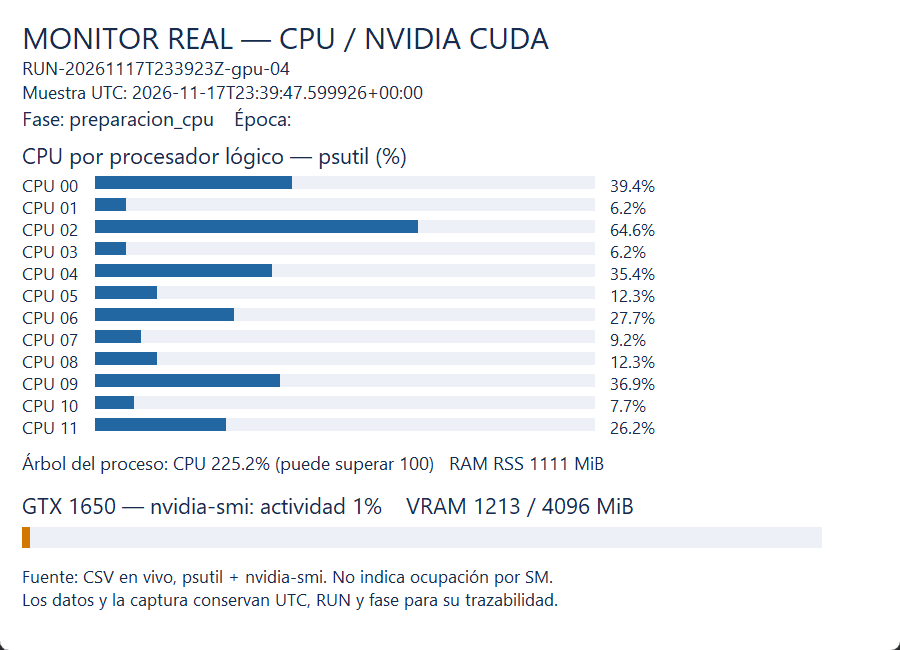
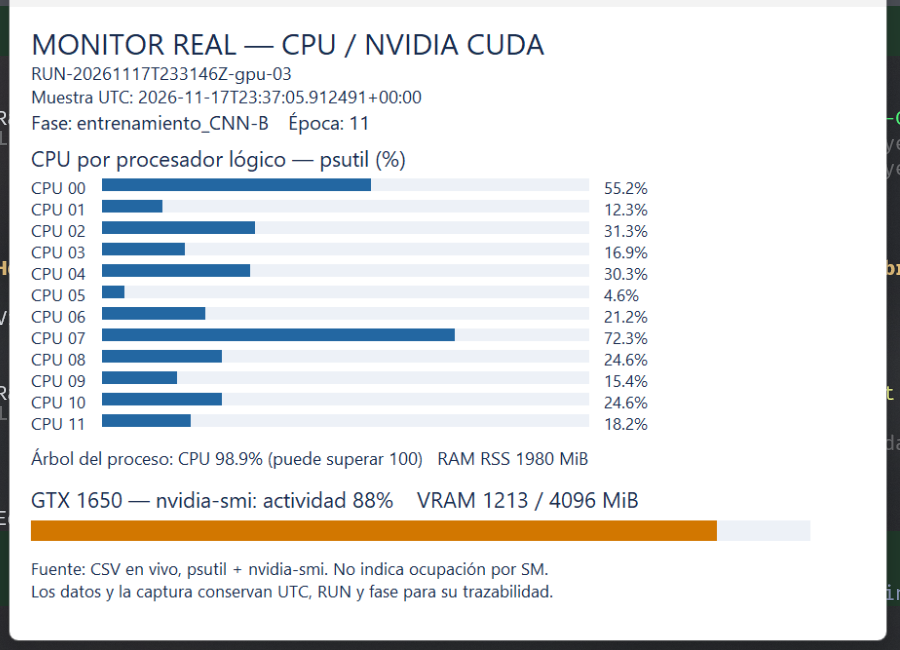
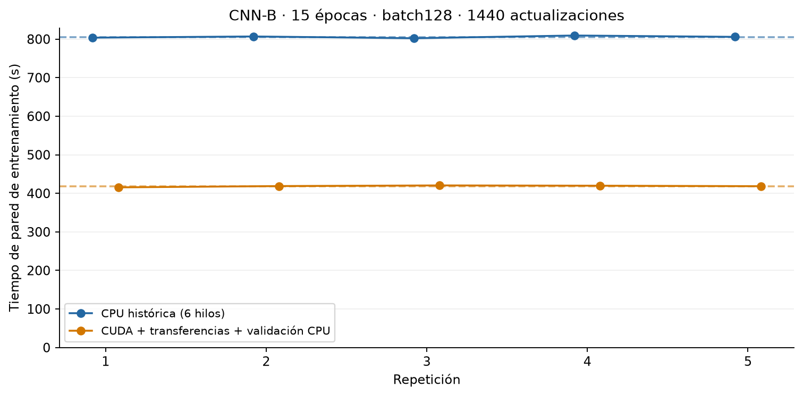
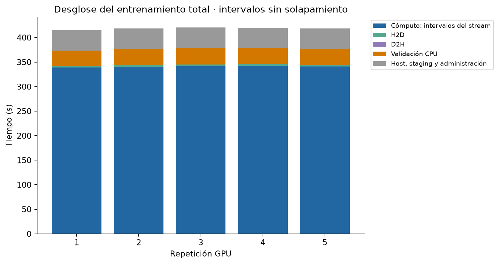
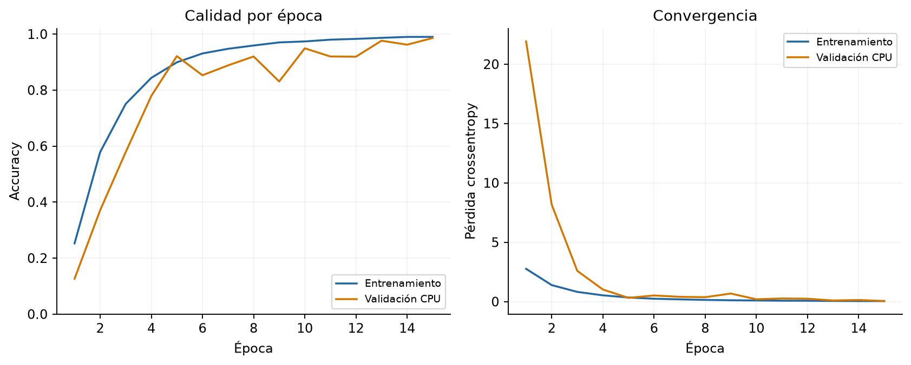
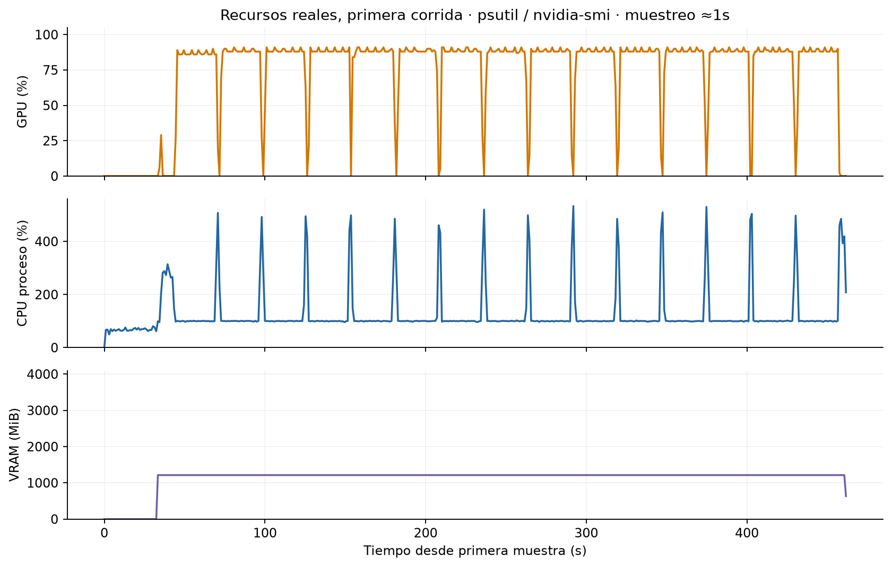

# Paso 5. Resultados reales CUDA Python — CNN-B

Estado: **5 corridas completas**, 15 épocas/1440 actualizaciones cada una. EXP: EXP-003.
Referencia CPU: cinco corridas históricas EXP-002. GPU: media **418.608 s**, DE 1.916 s; CPU: **805.650 s**.
Aceleración del entrenamiento completo: **1.925×** (cociente de medias). Incluye preparación de lotes/máscaras, H2D, D2H y validación CPU.
Accuracy test GPU: 98.621–98.621%. No se atribuye una mejora de calidad al hardware.

Accuracy CPU histórica CNN-B: 92.874–98.889%; valores individuales en calidad_comparada.csv.

## Condiciones, datos y procedimiento

Mismas 17,400 imágenes, manifiestos/splits 12180/2610/2610, RGB 64×64 float32 /255, pesos iniciales y Adam. Se verifican hashes fuente y de tensores preparados contra CPU. CNN-B original, cinco Conv, cuatro BN/Dropout, batch 128, último20,15 épocas sin EarlyStopping.
PCUDA existente; TensorFlow CPU conserva versiones y6hilos intra-op/1inter-op, BLAS6. No se reinstalaron NumPy/TensorFlow. GPU GTX 1650,4 GiB,toolkit 13.1,driver 591.59. Kernels Numba-CUDA Python y cuBLAS SGEMM pedantic FP32, sin TF32/mixed precision; un stream sin solapamiento.
Cada RUN es un proceso nuevo. Warmup128+20train,128val,32test, fuera de timing; restauración de pesos, Adam, BN y contador verificada. Se prepara en CPU con6 workers acotados y orden fijo; GPU ejecuta exclusivamente matemática del entrenamiento. Validación CPU2610imágenes cada época, batch 128, y test CPU2610,batch 32.
Temporización principal perf_counter_ns sincronizada; eventos CUDA por grupos. Los eventos son intervalos del stream y pueden incluir huecos Host; no equivalen a tiempo activo exclusivo de kernels. Monitoreo1s incluido, sin sustracción. Misma política de caché del SO sin vaciar; no se mide disco frío.
En los CSV crudos dispositivo=gpu identifica la variante del RUN, no que toda fase se ejecute en GPU. tiempos_clasificados.csv añade ejecutor_efectivo: preparación/validación/test son CPU; entrenamiento total es heterogéneo; forward/backward/Adam son GPU; copias son CPU↔GPU.
Cinco repeticiones iniciales; extensión7/9 solo si semiancho ICt95% de entrenamiento supera5%, según configuración previa. No se excluyen tiempos por ser lentos.

## Tiempos individuales

| RUN GPU | Preparación CPU (s) | Entrenamiento total (s) | Test CPU (s) | Accuracy test |
|---|---:|---:|---:|---:|
| RUN-20261117T231628Z-gpu-01 | 7.785 | 415.499 | 2.169 | 98.621% |
| RUN-20261117T232412Z-gpu-02 | 8.003 | 418.797 | 3.145 | 98.621% |
| RUN-20261117T233146Z-gpu-03 | 8.693 | 420.509 | 2.478 | 98.621% |
| RUN-20261117T233923Z-gpu-04 | 7.786 | 419.772 | 2.314 | 98.621% |
| RUN-20261117T234658Z-gpu-05 | 7.905 | 418.461 | 2.355 | 98.621% |

## Comparación por fase

| Fase | CPU media (s) | Variante CUDA media (s) | Cociente CPU/variante | Interpretación |
|---|---:|---:|---:|---|
| preparacion_cpu_s | 17.325 | 8.034 | 2.156× | CPU1vs6 workers, no CUDA |
| entrenamiento_s | 805.650 | 418.608 | 1.925× | Mismo alcance; incluye transferencias y validacion |
| evaluacion_cpu_s | 2.322 | 2.492 | 0.932× | Ambas evaluaciones CPU |
| suma_comparable_s | 825.297 | 429.134 | 1.923× | Mismo alcance; incluye transferencias y validacion |

La suma comparable usa únicamente preparación + entrenamiento CNN-B + evaluación CNN-B. Es un cálculo de tres fases, también para CPU; **no es todo el notebook original** ni el total adaptativo1858.617s. El pipeline GPU continuo incluye además auditoría explícita de tensores/administración; se publica por separado y no se divide por un total CPU de otro alcance.

## Variabilidad y descomposición

Entrenamiento GPU: n=5, mediana418.797s, rango[415.499,420.509]s, CV0.458%, ICt95% nominal[416.228,420.987]s. El intervalo supone observaciones aproximadamente independientes y no corrige deriva térmica.

| Componente GPU | Media (s) | Alcance |
|---|---:|---|
| computo_intervalos_stream_s | 340.815 | Forward/loss/backward/Adam/métricas: eventos |
| h2d_eventos_s | 3.313 | H2D: estado inicial,imágenes,labels,máscaras |
| d2h_eventos_s | 0.215 | D2H: control,pesos,BN,Adam |
| validacion_anidada_s | 32.324 | Validación CPU, anidada |
| administracion_y_staging_s | 41.941 | Residuo pared: staging,máscaras,lanzamientos,control,carga espejo |

Los componentes son parte del entrenamiento; no se suman de nuevo al total. La exportación final conservadora copia el modelo una vez adicional:16 copias de8984820bytes, incluidas en tiempo/payload. Por corrida entran19505052000bytes de imágenes+labels+máscaras, más estado inicial26946804bytes y reinicios de métricas; salen pesos/BN, controles y Adam final. Payload no equivale a tráfico físico PCIe medido.

## Corrección, calidad y cambios frente al diseño

51 pruebas de operadores y78 adjuntos con activaciones/dY idénticos aprobaron tolerancias; diez pasos sintéticos verificaron contador,exportación,CPUeval sin mutación y guardado/recarga exacta. Los diagnósticos globales estrictos fallidos se conservan: redondeo FP32 cambia algunas rutas MaxPooling cerca de empates (DEC-023); no se etiquetan como aprobados ni se promete trayectoria CPU/GPU idéntica.
Se mantiene el mismo Dropout/distribución y raíz43; el generador y el shuffle de NumPy no reproducen máscaras/orden internos históricos de TensorFlow. Esto conserva el volumen de cálculo; limita comparación de calidad y no constituye igualdad numérica. Se reportan resultados, no se ajustan épocas o semillas después de observar accuracy.
Cambio justificado DEC-022: kernels tiled explícitos fueron correctos localmente pero el ensayo≈0.60s/lote no mejoraba CPU; im2col/SGEMM≈0.26s/lote en admisión. La serie usa este último. Workspace576MiB, tope1408MiB; las jerarquías propias son256threads, reducción32×8,softmax32. Los grids internos cuBLAS los gestiona NVIDIA y no se atribuyen al equipo.
Los checkpoints finales se auditan por SHA-256, contenido canónico y contador Adam1440 en HDF5. Calidad real por RUN en calidad.csv y curvas; no se selecciona solo la mejor corrida. Los binarios grandes quedan en data/,fuera de Git,referenciados por manifiestos.

## Evidencia, límites y reproducción

La referencia CPU es histórica y no alternada con GPU: misma máquina, datos y plan ASUS Recommended, pero diferente instante/estado térmico. No se repitió la campaña CPU por indicación del usuario. Preparación cambia1→6 workers; su cociente es mejora CPU, no CUDA. El muestreo GPU agregado no demuestra ocupación por SM ni saturación de toda la VRAM.
La ejecución de IPython puede registrar un fallo de historial SQLite de usuario en sandbox; stdout/stderr se conservan y no afecta los procesos de entrenamiento, cuyos códigos, tiempos y checkpoints se verifican independientemente. No se utiliza ese historial como evidencia experimental.
- [Configuración congelada](configuracion.json), [serie](serie.json), [tiempos crudos](tiempos_medidos.csv).
- [Resumen estadístico](resumen.csv), [speedup](speedup.csv), [comparación individual](comparacion_cnn_b.csv).
- [Comparabilidad y diferencias aceptadas](comparabilidad.csv), [ejecutor efectivo por fase](tiempos_clasificados.csv) y [fuentes transitivas](fuentes_transitivas_verificadas.json).
- [Calidad](calidad.csv), [recursos](recursos_resumen.csv), [checkpoints](validacion_checkpoints.json).
- [Notebook fuente](../../../notebooks/Lab3_ASL_CUDA.ipynb) y [procedimiento](../../../docs/trazabilidad/implementacion-cuda.md).
- [Notebook que lanzó las mediciones](notebook-ejecutado.ipynb), [vista ejecutada validada](notebook-validado.ipynb) y [código de salida/serie sin repeticiones](notebook-validado.salida.json).

Cada RUN contiene invocación exacta, contexto/fuentes, hashes, logs, CSV por época, transferencias y recursos. Los archivos artefactos.csv se verifican antes de resumir. Para no repetir corridas, el notebook reutiliza la serie si ya está completa; una serie incompleta exige diagnóstico.

## Capturas reales de uso

[Índice de capturas y muestras originales](../../evidencias/EXP-003/README.md). Se conservan los intentos preliminares excluidos por DPI, sin sobrescribirlos.

## Gráficas

## Informe PDF

[Informe de ejecución CUDA](informe-paso-5.pdf). Los Markdown y CSV son las fuentes verificables; el PDF no sustituye datos crudos.
