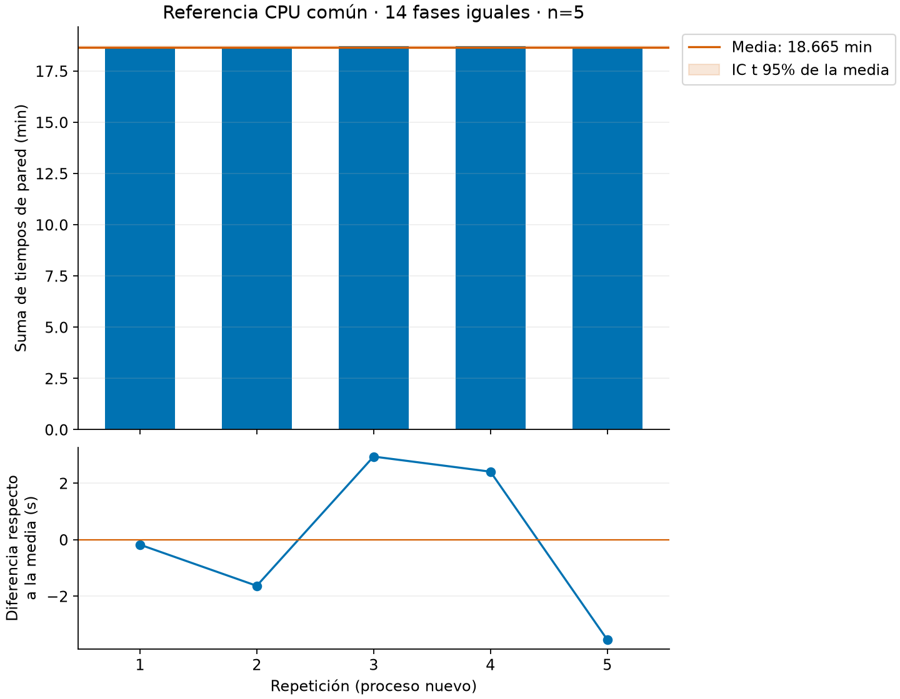
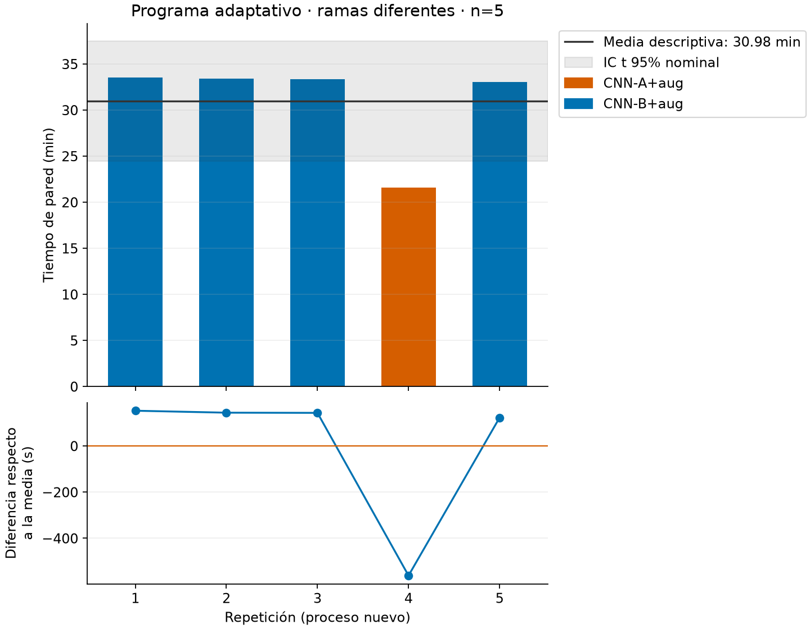
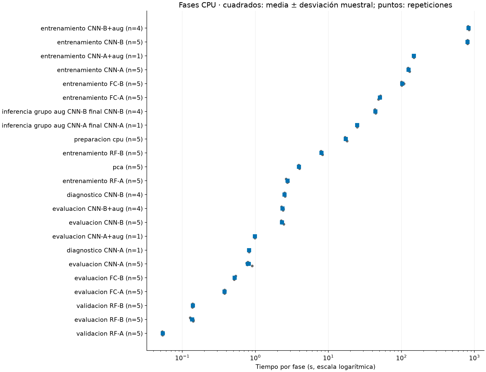
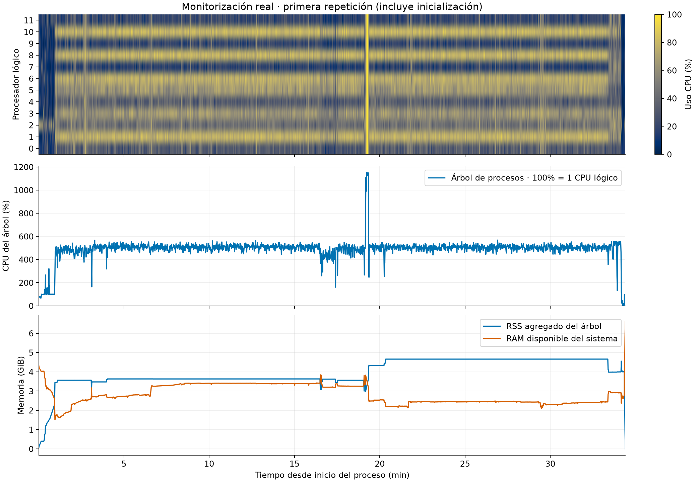

# Paso 2. Resultados detallados de ejecución CPU

Generado UTC: 2026-11-17T21:45:55.179578+00:00. EXP-002; PCUDA; sin reinstalación ni descarga.

## Resultado principal: referencia de carga común

En 5 procesos nuevos, las 14 fases comunes tardaron **1119.928 s (18.665 min) en promedio**.
DE muestral: 2.723 s; mediana: 1119.751 s; CV: 0.24%; IC t95% nominal: [1116.546, 1123.309] s.
Semiancho relativo del IC común: 0.30%; objetivo revisado ≤5%: cumplido.
Esta referencia suma 14 intervalos de pared no solapados: preparación, fit/evaluate de las cuatro redes base, PCA y fit/validación de los dos bosques. Son 60 épocas neuronales base por corrida; la validación interna de fit ya está incluida. No es el tiempo continuo del programa completo ni tiempo exclusivo de kernels.
La referencia común procede de DEC-015, definida en EXP-002 al detectar un cambio de arquitectura en la cuarta corrida, antes del resultado de la quinta. Se conservaron todas las observaciones; no se eligieron fases por ser más rápidas ni se descartó la rama distinta.

## Programa adaptativo bajo el protocolo de 15 épocas: total descriptivo

El pipeline continuo tardó **1858.617 s (30.977 min) en promedio descriptivo**, mezclando las ramas realmente elegidas.
Desviación muestral: 314.366 s; CV: 16.91%; IC t 95% de la media: [1468.280, 2248.953] s.
Semiancho relativo del IC del total: 21.00%. La regla inicial de precisión del total se suspendió por falta de homogeneidad: no se afirma cumplida ni se usa esta mezcla como baseline de carga fija para GPU.
El programa selecciona la CNN a aumentar por test accuracy. Se observó: repetición 1: CNN-B+aug; repetición 2: CNN-B+aug; repetición 3: CNN-B+aug; repetición 4: CNN-A+aug; repetición 5: CNN-B+aug. Cambiar de arquitectura modifica el cómputo de las 15 épocas. Diagnóstico e inferencia se estratifican según la selección.

No se han medido GPU, transferencias ni speedup. El IC describe estas condiciones; no garantiza independencia ni ausencia de deriva térmica.

## Datos y alcance

Dataset local ASL Alphabet v1: 87,000 archivos inventariados; 17,400 seleccionados (600/clase), splits 12,180/2,610/2,610. Fotos propias: 15.
Se identificaron 0 grupos de hashes duplicados en la selección y 0 grupos entre splits. No se excluyeron archivos. La ausencia de duplicados exactos no demuestra independencia de sujetos/sesiones.
Se ejecutan las funciones originales de preparación y construcción, cinco entrenamientos neuronales, PCA, dos bosques y evaluación/inferencia. Se excluyen descarga, EDA, renderizado y recarga redundante. El notebook original permanece intacto.
Diferencias controladas: 15 épocas por red, EarlyStopping desactivado sin restaurar mejor época, seeds/threads explícitos. La longitud por red es fija, pero la arquitectura adaptativa no siempre coincide; por eso se separa la referencia común del total.

Por ese ajuste experimental, estos tiempos no equivalen a ejecutar el notebook íntegro con su parada temprana, restauración del mejor epoch, EDA y figuras. Se documenta el alcance medido y se conserva el original.

## Condiciones y procedimiento

CPU: AMD Ryzen 5 4600H with Radeon Graphics; 6 núcleos físicos/12 lógicos; RAM 15.42 GiB.
PCUDA; TensorFlow CPU, GPU ocultada y dispositivo efectivo registrado. Intra-op 6, inter-op 1, BLAS 6; RF conserva n_jobs=-1. Preparación de imágenes con el bucle original de un worker.
Cada repetición valida hashes, construye/calienta candidatos y restaura todas sus variables/optimizador; después cronometra preparación y operaciones del programa. Warmup y checkpoints quedan fuera del total.
Temporizador: perf_counter_ns. El total es un intervalo continuo; incluye administración y logging internos. Las fases de validación anidada ya están incluidas en fit y no deben sumarse dos veces.
La caché de archivos del SO no se vació y los hashes se leyeron antes del timing: estos tiempos no describen una primera lectura de disco frío. Imports y arranque del proceso se registran pero no se incluyen en pipeline_total.
Se conservaron todas las repeticiones; no se eliminaron observaciones por ser lentas ni por accuracy. Monitorización externa cada 1 s. Un supervisor de cierre se añadió al detectar la rama distinta: lee estado cada 10 s y solo acelera el sondeo durante inferencia, fuera de las 14 fases comunes.
El controlador original y su configuración permanecieron intactos. El supervisor lo detuvo después de cinco salidas correctas para evitar ampliar una mezcla como si fuera homogénea; estado previo y revisión en cierre-alcance.md/serie-antes-cierre.json.

## Tiempos por repetición

| Repetición | RUN | Referencia común (s) | Total adaptativo (s) | CNN aumentada | Modelo final |
|---:|---|---:|---:|---|---|
| 1 | [RUN-20261117T171942Z-cpu-01](RUN-20261117T171942Z-cpu-01/registro.md) | 1119.751 | 2011.095 | CNN-B+aug | CNN-B |
| 2 | [RUN-20261117T175407Z-cpu-02](RUN-20261117T175407Z-cpu-02/registro.md) | 1118.294 | 2002.552 | CNN-B+aug | CNN-B |
| 3 | [RUN-20261117T182835Z-cpu-03](RUN-20261117T182835Z-cpu-03/registro.md) | 1122.869 | 2001.774 | CNN-B+aug | CNN-B |
| 4 | [RUN-20261117T190250Z-cpu-04](RUN-20261117T190250Z-cpu-04/registro.md) | 1122.335 | 1296.610 | CNN-A+aug | CNN-A |
| 5 | [RUN-20261117T192509Z-cpu-05](RUN-20261117T192509Z-cpu-05/registro.md) | 1116.389 | 1981.052 | CNN-B+aug | CNN-B |

## Total estratificado por CNN aumentada

| Rama | n | Media total (s) | DE muestral (s) | IC t 95% nominal (s) |
|---|---:|---:|---:|---|
| CNN-B+aug | 4 | 1999.118 | 12.763 | 1978.810–2019.426 |
| CNN-A+aug | 1 | 1296.610 | N/A | N/A |

## Estadísticas por fase

| Fase | n | Media (s) | Mediana (s) | DE muestral (s) | Mín–máx (s) | CV (%) |
|---|---:|---:|---:|---:|---:|---:|
| preparacion_cpu | 5 | 17.325 | 17.267 | 0.414 | 16.880–17.963 | 2.39 |
| entrenamiento_CNN-A | 5 | 124.839 | 123.740 | 2.504 | 123.117–129.078 | 2.01 |
| validacion_anidada_CNN-A (anidada) | 5 | 7.960 | 7.928 | 0.205 | 7.749–8.300 | 2.57 |
| evaluacion_CNN-A | 5 | 0.802 | 0.785 | 0.058 | 0.759–0.904 | 7.28 |
| entrenamiento_CNN-B | 5 | 805.650 | 805.848 | 2.723 | 802.320–809.363 | 0.34 |
| validacion_anidada_CNN-B (anidada) | 5 | 31.715 | 31.501 | 0.488 | 31.300–32.354 | 1.54 |
| evaluacion_CNN-B | 5 | 2.322 | 2.298 | 0.072 | 2.265–2.445 | 3.09 |
| diagnostico_CNN-B | 4 | 2.508 | 2.504 | 0.029 | 2.476–2.547 | 1.17 |
| entrenamiento_FC-A | 5 | 50.716 | 51.378 | 1.265 | 48.520–51.495 | 2.49 |
| validacion_anidada_FC-A (anidada) | 5 | 2.291 | 2.290 | 0.033 | 2.240–2.332 | 1.46 |
| evaluacion_FC-A | 5 | 0.379 | 0.378 | 0.006 | 0.373–0.388 | 1.51 |
| entrenamiento_FC-B | 5 | 102.441 | 100.825 | 3.275 | 100.347–108.090 | 3.20 |
| validacion_anidada_FC-B (anidada) | 5 | 3.832 | 3.802 | 0.070 | 3.753–3.913 | 1.84 |
| evaluacion_FC-B | 5 | 0.520 | 0.517 | 0.011 | 0.510–0.537 | 2.21 |
| pca | 5 | 3.963 | 3.960 | 0.046 | 3.906–4.025 | 1.16 |
| entrenamiento_RF-A | 5 | 2.753 | 2.772 | 0.074 | 2.631–2.816 | 2.68 |
| validacion_RF-A | 5 | 0.054 | 0.053 | 0.001 | 0.053–0.055 | 1.77 |
| entrenamiento_RF-B | 5 | 8.025 | 7.949 | 0.187 | 7.839–8.322 | 2.32 |
| validacion_RF-B | 5 | 0.139 | 0.139 | 0.001 | 0.137–0.141 | 0.81 |
| evaluacion_RF-B | 5 | 0.136 | 0.140 | 0.007 | 0.128–0.141 | 5.01 |
| entrenamiento_CNN-B+aug | 4 | 830.735 | 832.394 | 10.662 | 816.400–841.753 | 1.28 |
| validacion_anidada_CNN-B+aug (anidada) | 4 | 31.871 | 31.906 | 0.467 | 31.361–32.309 | 1.47 |
| evaluacion_CNN-B+aug | 4 | 2.345 | 2.336 | 0.078 | 2.272–2.437 | 3.32 |
| inferencia_grupo_aug_CNN-B_final_CNN-B | 4 | 43.957 | 43.987 | 0.637 | 43.261–44.592 | 1.45 |
| pipeline_total | 5 | 1858.617 | 2001.774 | 314.366 | 1296.610–2011.095 | 16.91 |
| diagnostico_CNN-A | 1 | 0.819 | 0.819 | N/A | 0.819–0.819 | N/A |
| entrenamiento_CNN-A+aug | 1 | 147.480 | 147.480 | N/A | 147.480–147.480 | N/A |
| validacion_anidada_CNN-A+aug (anidada) | 1 | 7.805 | 7.805 | N/A | 7.805–7.805 | N/A |
| evaluacion_CNN-A+aug | 1 | 0.981 | 0.981 | N/A | 0.981–0.981 | N/A |
| inferencia_grupo_aug_CNN-A_final_CNN-A | 1 | 24.763 | 24.763 | N/A | 24.763–24.763 | N/A |

## Gráficas









La última figura se deriva del CSV real del monitor; no es una captura del Administrador de tareas ni prueba de GPU. Las fases con n=1 no tienen estimación de DE/IC: se muestran N/A, sin inventar ceros.

## Corrección y repetibilidad

Identidad de tensores entre corridas: True. Identidad del estado inicial completo por arquitectura: True. Misma selección de arquitecturas/modelos: False.
Paquetes idénticos: True; fotos propias idénticas: True; accuracy dentro de la tolerancia predefinida 1e-6: False. La repetibilidad numérica se informa separada de la equivalencia de carga.
Selección de arquitectura de entrenamiento constante: False; arquitectura efectiva de inferencia constante: False. Los ganadores exactos se conservan en metricas.json por RUN; no se descartan corridas por menor accuracy.
Los checkpoints iniciales incluyen variables de modelo, estadísticas BN, estados aleatorios y optimizador. Se validó su restauración tras warmup. Shapes, dtype, rango y valores finitos se comprobaron después del intervalo medido.

Los archivos .keras finales se verificaron por SHA-256 y su contador de Adam contiene 1,440 actualizaciones por red: evidencia adicional de los pasos efectivos y de que el warmup no añadió actualizaciones al entrenamiento medido. Auditoría en pasos_verificados.csv.

| Modelo | n | Accuracy test mínimo | Accuracy test máximo | Diferencia |
|---|---:|---:|---:|---:|
| CNN-A | 5 | 0.930651 | 0.930651 | 0.00000000 |
| CNN-A+aug | 1 | 0.841762 | 0.841762 | N/A |
| CNN-B | 5 | 0.928736 | 0.988889 | 0.06015325 |
| CNN-B+aug | 4 | 0.867433 | 0.970498 | 0.10306513 |
| FC-A | 5 | 0.530651 | 0.530651 | 0.00000000 |
| FC-B | 5 | 0.442912 | 0.442912 | 0.00000000 |
| RF-B | 5 | 0.897701 | 0.897701 | 0.00000000 |

## Análisis de rendimiento y factores

Las fases de entrenamiento base y bosques representan 97.72% del tiempo contabilizado en la referencia común. La tabla identifica operaciones dominantes sin atribuir a kernels el tiempo completo de fit.
El fit de CNN-B consume por sí solo 71.94% de la referencia común; es la fase base dominante observada. Preparación CPU representa 1.55%.
El cambio de rama adaptativa es un factor de rendimiento observado directamente: aumentar CNN-A y aumentar CNN-B no ejecutan la misma arquitectura. Se conservan ambos tiempos con su n; mezclar sus fases ocultaría la causa de la dispersión del programa completo.
La mayor profundidad, mapas de activación y BatchNormalization de CNN-B incrementan el trabajo frente a CNN-A; el aumento añade transformaciones por lote. La comparación entre modelos describe cargas diferentes, no speedup de implementaciones equivalentes.
PCA reduce el coste del bosque al transformar 12,288 variables en 150, pero su ajuste/proyección también consume tiempo. Los bosques usan varios hilos; esta referencia CPU no debe llamarse monohilo.
Lectura/decodificación, resize y normalización están combinados en preparacion_cpu; este experimento no permite atribuir causalmente sus costes individuales. Disco, caché y competencia con otros procesos influyen en esa fase.
Batch 128 y 15 épocas fijan los pasos de cada arquitectura base y reutilizan imágenes en RAM; la selección posterior sigue siendo adaptativa. EarlyStopping habría añadido otra fuente de variación. Fit incluye validación y sobrecostes de Keras.
Frecuencia dinámica, refrigeración, plan de energía, carga externa y presión de RAM pueden producir variación. Se conserva CPU/RAM por segundo; no se midió potencia ni temperatura, por lo que no se afirma throttling como causa demostrada.
Las predicciones individuales de fotos propias generan numerosas invocaciones pequeñas; difieren del throughput de inferencia por lotes. El control, adaptación de datos y llamadas del framework forman parte de ese tiempo.
Los resultados corresponden a este portátil, este entorno y esta selección. Elegir por test es una limitación heredada de calidad; no se pretendió corregirla ni ajustar dependencias para forzar coincidencia de accuracy durante el benchmark.

## Reproducción y artefactos

Configuración ejecutada: [EXP-002.json](../../../configuraciones/EXP-002.json). [Manifiesto de fuentes](manifest_fuente.csv), [splits](manifest_splits.csv), [mapeo](label_mapping.json), [auditoría de datos](validacion_datos.json), [resumen por fase](resumen.csv), [referencia común](resumen_referencia_comun.csv), [serie](serie.json), [revisión del cierre](cierre-alcance.md), [preservación local de entradas](preservacion-datos.md).

Guía de ejecución nueva y recuperación sin descarga: [reproducir-exp-002.md](../../../docs/trazabilidad/reproducir-exp-002.md). Desde la raíz, con PCUDA, regenerar únicamente el análisis:

```powershell
.\PCUDA\Scripts\python.exe -X utf8 scripts/resumir_cpu.py
```

El controlador rechaza sobreescribir una serie iniciada. Para repetir experimentalmente, conservar EXP-002 y crear otro identificador/configuración con los mismos manifiestos y pesos iniciales; no borrar resultados para reutilizar el nombre.
Los checkpoints se conservan localmente en data/EXP-002, con rutas y hashes en cada RUN. No se descargan modelos ni datos. Esta ejecución no demuestra todavía reconstrucción del entorno desde cero ni comparación GPU.

Los intervalos t son nominales y el alcance común se revisó durante el estudio por una rama adaptativa observada. Se presenta esta revisión exploratoria, sus motivos y todos los datos; no se promete cobertura exacta ni inferencia sobre otras máquinas.
La serie previa EXP-001 fue interrumpida por registrar el lanzador del venv en lugar del hijo TensorFlow. Se conserva como fallida y no aporta observaciones al promedio; EXP-002 corrige el monitor del árbol de procesos.
El entorno instalado emitió avisos sobre retracing y un atributo de MapDataset desconocido que el runtime indica ignorar. Se conservan en stderr; no se reinstaló el stack. No se demuestra su coste causal con esta serie.

**Límite observado:** no se reproduce la trayectoria de aprendizaje dentro de 1e-6 en todas las redes, pese a seeds, estados iniciales y tensores coincidentes. No se ha aislado si la causa está en reducciones numéricas, estados aleatorios internos u otro detalle del stack. La carga de las 14 fases comunes es equivalente; la del pipeline adaptativo completo no. No se certifica entrenamiento bit a bit ni se alteran dependencias para ocultar la variación.

## Recursos observados

Resumen de todo el proceso (incluye warmup y persistencia): CPU 100% representa un procesador lógico; RSS suma working sets del árbol y puede duplicar memoria compartida.

| RUN | CPU árbol media (%) | CPU árbol máximo (%) | RSS árbol pico (GiB) | RAM disponible mínima (GiB) |
|---|---:|---:|---:|---:|
| RUN-20261117T171942Z-cpu-01 | 487.68 | 1151.60 | 4.660 | 1.523 |
| RUN-20261117T175407Z-cpu-02 | 485.29 | 1137.20 | 4.470 | 2.205 |
| RUN-20261117T182835Z-cpu-03 | 488.33 | 1145.00 | 4.667 | 2.559 |
| RUN-20261117T190250Z-cpu-04 | 479.89 | 1157.70 | 4.350 | 2.762 |
| RUN-20261117T192509Z-cpu-05 | 487.21 | 1161.80 | 4.664 | 2.500 |

Plan de energía consultado antes de la serie: ASUS Recommended; registro en plan-energia.txt. No se alteró ese plan. No se controlaron los procesos de otras aplicaciones.
